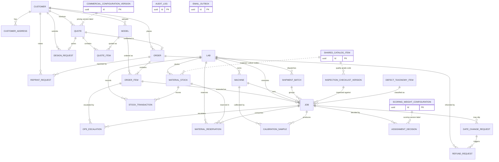
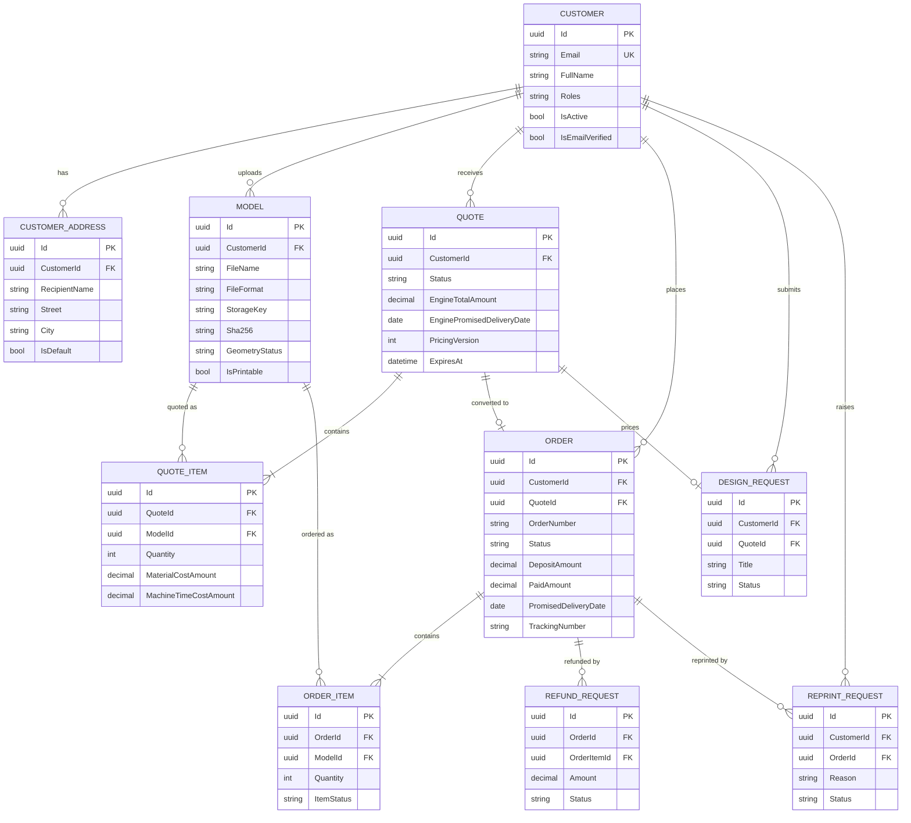
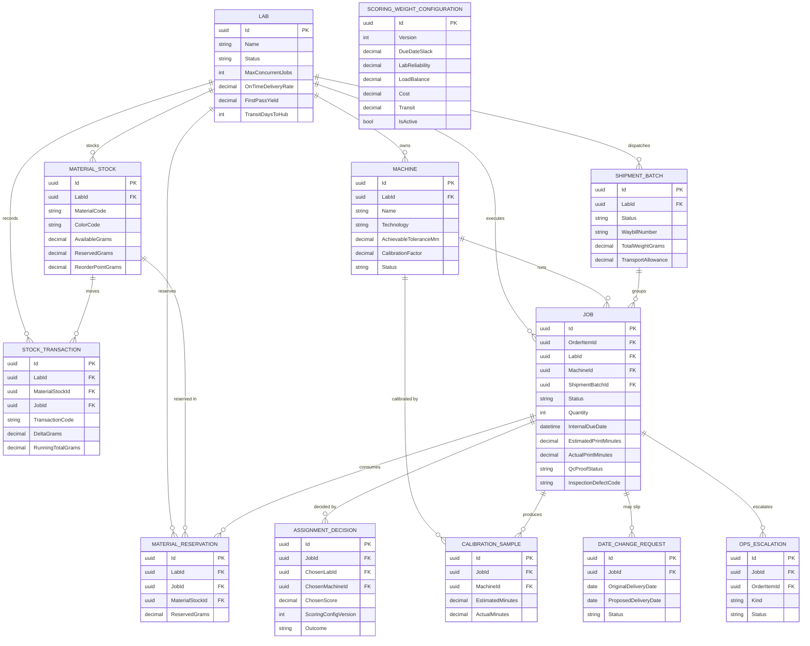
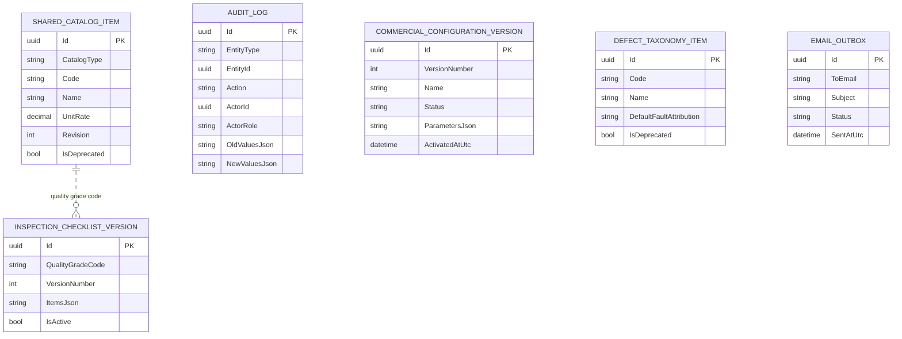

# Report 3 — 3.1.5 Entity Relationship Diagram (draft cho PrintGrid)

**Nguồn:** `src/PrintGrid.Infrastructure.Shared/Persistence/Migrations/PrintGridDbContextModelSnapshot.cs`
(EF Core model snapshot — trạng thái schema cuối cùng sau toàn bộ migration, 28/10/2026).

> **Quyết định quan trọng:** ERD dưới đây dựng từ **schema thật trong code**, không lấy từ
> `documentation/project/design/16-Database-ERD.md`. Lý do: bản thiết kế cũ có `User`, `Payment`,
> `Shipment`, `InspectionResult` — bốn entity này **không tồn tại thành bảng riêng** trong migration.
> Nếu nộp ERD cũ, hội đồng mở DB ra đối chiếu sẽ thấy lệch ngay.
> Bảng "Ghi chú ánh xạ" ở cuối file giải thích mỗi khái niệm cũ nằm ở đâu trong schema thật.

**Tổ chức schema:** một database `printgrid_db`, 3 schema — `customer`, `scheduling`, `admin` — cộng
bảng hạ tầng `shared.email_outbox`.

---

## Diagram 1 — ERD tổng quan (dùng làm hình chính)

> Năm entity admin/hạ tầng đứng độc lập (không FK) nên chỉ hiện dạng hộp. `AUDIT_LOG` trỏ tới mọi entity
> bằng cặp `EntityType + EntityId` (quan hệ đa hình, cố ý không có FK).
>
> Đường **nét đứt** (`..`) = quan hệ **phi định danh**: tham chiếu bằng *mã nghiệp vụ* hoặc *nhãn phiên bản*,
> không có ràng buộc khoá ngoại ở DB. Xem mục "Vì sao các bảng tham chiếu không có FK" bên dưới.

---

## Diagram 2 — Schema `customer` (có thuộc tính)

---

## Diagram 3 — Schema `scheduling` (có thuộc tính)

**Cross-schema FK (không vẽ lại để tránh rối):** `JOB.OrderItemId → customer.order_items`,
`JOB.ModelId → customer.models`,
`JOB.InspectionChecklistVersionId → admin.inspection_checklist_versions`,
`JOB.InspectionDefectCode → admin.defect_taxonomy_items`.

---

## Diagram 4 — Schema `admin` + hạ tầng

---

## Entities Description

| # | Entity | Description |
|---|--------|-------------|
| 1 | Customer | The single identity table for every user — customers and staff. Holds credentials (hash only), Google subject, email-verification and password-reset tokens, and a `Roles` column that determines which portal the account may enter. There is no separate `User` table. |
| 2 | CustomerAddress | Saved delivery addresses with a default flag. An address referenced by an open order cannot be deleted. |
| 3 | Model | Uploaded 3D file: storage key, SHA-256, size, format, geometry analysis result (bbox, volume, watertight/manifold, printable) and the estimated print time/material used by quoting. |
| 4 | Quote | Priced offer with the **frozen** pricing version, the engine's promised date, the placement basis, the staff adjustment reason/approver and the expiry timestamp. Status drives the draft → published → accepted/expired lifecycle. |
| 5 | QuoteItem | One configured item in a quote: model, quantity, bounding box and the split of material cost vs machine-time cost. |
| 6 | Order | Committed purchase: order number, status, promised date, deposit/paid/refunded amounts, external gateway transaction id, tracking number and delivery confirmation. No separate `Payment` table — payment state is denormalised here. |
| 7 | OrderItem | One item of an order and its production status. Each item becomes one or more jobs. |
| 8 | DesignRequest | Customer brief for a model that does not exist yet; links to the design quote and later to the delivered STL. |
| 9 | ReprintRequest | Post-delivery complaint with reason, photos and resolution note; allowed only inside the guarantee window. |
| 10 | RefundRequest | Full or per-item refund case with amount, reason, status and the gateway transaction it reverses. |
| 11 | Lab | Partner print shop: identity, location, working calendar, transit days/zone, capacity cap, and the performance metrics (on-time rate, first-pass yield, standing flag) that feed assignment scoring. |
| 12 | Machine | Print capability (technology, tolerance, layer range), calibration factor/MAPE, and maintenance window. The capability filter reads this table. |
| 13 | MaterialStock | Per-lab, per-material/colour stock: available grams, reserved grams and reorder point. |
| 14 | MaterialReservation | Grams reserved when a job is accepted; settled against actual consumption on completion. |
| 15 | StockTransaction | Immutable stock movement (in/out/adjust) with a transaction code and running total — the audit trail for inventory. |
| 16 | Job | The schedulable unit: assigned lab/machine, queue dates (planned start/end, internal due), estimated vs actual time and material, QC-proof state, inspection result and defect attribution, reprint index and shipment batch. |
| 17 | AssignmentDecision | Append-only decision log per assignment attempt: trigger, candidate and ranking JSON, chosen pair, score, scoring-config version, elapsed time and outcome. This is what Decision Trace renders. |
| 18 | CalibrationSample | One (estimated, actual) pair per completed job per machine; the nightly calibration job fits correction factors from these. |
| 19 | DateChangeRequest | Proposed delivery-date change with its consent token, original vs proposed date and the customer's decision. |
| 20 | ShipmentBatch | Lab→hub run: grouped proof-approved jobs, weight, transport zone/allowance, waybill and the sealed/received timestamps. |
| 21 | OpsEscalation | Human-intervention queue item (no feasible lab, reprint limit, SLA risk) with kind, reason, status and resolution time. |
| 22 | ScoringWeightConfiguration | Versioned assignment weights (due-date slack, reliability, load balance, cost, transit) with change reason and active flag. A new version must total 1.0. |
| 23 | AuditLog | Append-only audit record for every mutation: actor/role, entity type + id (polymorphic), action class, before/after JSON, IP, trace id and the requirement codes it satisfies. |
| 24 | CommercialConfigurationVersion | Versioned commercial parameters (pricing inputs, deposit %, shipping thresholds, review band) stored as JSON with activation time; historical versions stay readable. |
| 25 | InspectionChecklistVersion | Versioned, grade-bound checklist definition (items as JSON). A running inspection keeps the version it started with. |
| 26 | DefectTaxonomyItem | Defect code, name and default fault attribution (Lab / Hub / Customer). Referenced codes can only be deprecated. |
| 27 | SharedCatalogItem | Materials, colours, technologies, quality grades and post-processing options, versioned by revision; in-use entries are deprecated, never deleted. |
| 28 | EmailOutbox | Durable outbound-email queue (verification, reset, upload receipt, status alerts) drained by the recurring delivery job every minute. |

---

## Vì sao scoring / commercial / catalog / email không có FK

Đây là **reference data** và **hạ tầng**, không phải dữ liệu giao dịch. Chúng được tham chiếu bằng
**mã nghiệp vụ** hoặc **nhãn phiên bản**, không bằng khoá ngoại UUID.

| Bảng | Bản chất | Được dùng bởi | Cách tham chiếu (đã kiểm tra trong code) |
|------|----------|---------------|------------------------------------------|
| `scoring_weight_configurations` | Bộ trọng số xếp lịch có phiên bản (5 tiêu chí, tổng = 1.0, `IsActive`) | Assignment Engine → `assignment_decisions` | `ScoringConfigVersion` kiểu **varchar(16)** + `ScoringConfigJson` (snapshot toàn bộ cấu hình) |
| `commercial_configuration_versions` | Tham số thương mại/giá có phiên bản (`ParametersJson`, `Status`) | Pricing Engine → `quotes` | `PricingVersion` kiểu **varchar(16)**; số tiền đã tính chốt trên `quote_items` |
| `shared_catalog_items` | Vật liệu / màu / công nghệ / cấp chất lượng / hậu xử lý (`CatalogType + Code`, revision) | `material_stocks`, `jobs`, `inspection_checklist_versions` | `MaterialCode`, `ColorCode`, `QualityGradeCode`, `InspectionDefectCode` — **mã**, không phải UUID |
| `email_outbox` | Hàng đợi email theo transactional-outbox | — | `ToEmail` (địa chỉ đã resolve), **không** phải `CustomerId` |

**Bốn lý do thiết kế:**

1. **Tái lập được (reproducibility).** BR-QUOTE-004 / FR-SCHED-010 yêu cầu: chạy lại báo giá với
   parameter-set đã đóng băng phải ra đúng giá cũ. Comment trong `Quote.cs` ghi rõ
   *"Pricing parameter-set version frozen at quote time"*. Nếu dùng FK trỏ tới bản ghi "đang active",
   mỗi lần sửa tham số sẽ làm sai lịch sử. Vì vậy quote giữ **nhãn version + số tiền đã tính**,
   decision log giữ **nguyên JSON cấu hình**.
2. **Deprecate, không xoá.** Catalog item đang dùng chỉ đổi `IsDeprecated = true`; mã vẫn tồn tại nên
   dữ liệu cũ vẫn đọc được. FK sẽ biến thao tác "ngừng dùng" thành "không xoá được" hoặc phải cascade.
3. **Ranh giới module.** Đây là modular monolith: `customer`/`scheduling` không navigation/FK sang bảng
   của `admin`; chúng giữ id/mã/version. Nhờ vậy có thể tách module hoặc đổi schema mà không phá
   ràng buộc chéo.
4. **Outbox là hạ tầng.** Email có thể gửi tới địa chỉ không phải customer (liên hệ xưởng, cảnh báo ops),
   nên không gắn FK; bảng nằm ở schema `shared` và được ghi trong **cùng transaction** với nghiệp vụ.

**Đánh đổi (nên nói trước nếu bị hỏi):** bốn bảng này không có ràng buộc toàn vẹn ở mức DB. Tính đúng
đắn do validator/handler đảm bảo và mọi thay đổi đều vào `audit_logs`. Đây là lựa chọn có ý thức, không
phải thiếu sót.

> Lưu ý phân biệt: `inspection_checklist_versions` và `defect_taxonomy_items` **có** quan hệ thật với
> `jobs` (checklist theo UUID FK, defect theo mã) nên trong ERD vẽ **nét liền**, không phải nét đứt.

---

## Ghi chú ánh xạ (nếu bị hỏi "entity X trong thiết kế cũ đâu?")

| Khái niệm trong `16-Database-ERD.md` | Thực tế trong schema |
|---|---|
| `User` | Gộp vào `customers` (có `Roles`, `PasswordHash`, `IsActive`); không còn bảng `users` |
| `Payment` | Không có bảng riêng. Trạng thái tiền nằm trên `orders` (`DepositAmount`, `PaidAmount`, `RefundedAmount`, `PaymentTransactionId`) và `refund_requests`; giao dịch thật do gateway nắm |
| `Shipment` | Là `shipment_batches` (chuyến lab→hub). Mã vận đơn của đơn gửi khách nằm ở `orders.TrackingNumber` |
| `InspectionResult` | Gộp vào `jobs` (`InspectionChecklistResultsJson`, `InspectionDefectCode`, `InspectionFaultAttribution`, `InspectedAtUtc`) và `InspectionChecklistVersion` |
| `Assignment`, `DecisionLog` | `assignment_decisions` (một bảng, log append-only) |
| `CalibrationData` | `calibration_samples` + các cột `Calibration*` trên `machines` |
| `Configuration` | Ba bảng versioned riêng: `commercial_configuration_versions`, `scoring_weight_configurations`, `shared_catalog_items` |

**Số liệu để ghi dưới hình:** 28 entity · 3 schema (`customer`, `scheduling`, `admin`) + `shared` ·
35 quan hệ · toàn bộ khoá chính là `uuid`.

---

## Cách đưa vào Word

1. Export **Diagram 1** làm *Hình 3.x – Entity Relationship Diagram* (A4 landscape hoặc A3).
2. Nếu trang không đủ, đặt Diagram 2–4 ở phụ lục (mỗi schema một hình) — dễ đọc hơn nhiều so với nhồi 28 entity vào một trang.
3. Ký hiệu Mermaid: `||--o{` = một–nhiều (tuỳ chọn), `||--|{` = một–nhiều (bắt buộc), `||--o|` = một–không hoặc một.
   Ghi chú dưới caption nếu GVHD không quen ký hiệu crow's foot.
4. Nếu cần ERD dạng "hộp + đường" cổ điển (không có thuộc tính), dùng Diagram 1; nếu cần thấy khoá, dùng Diagram 2–4.
