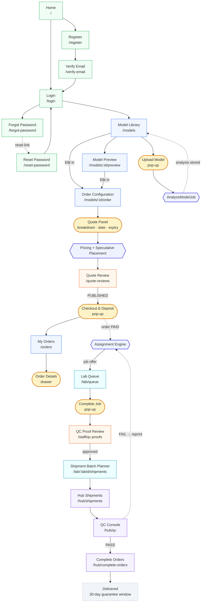
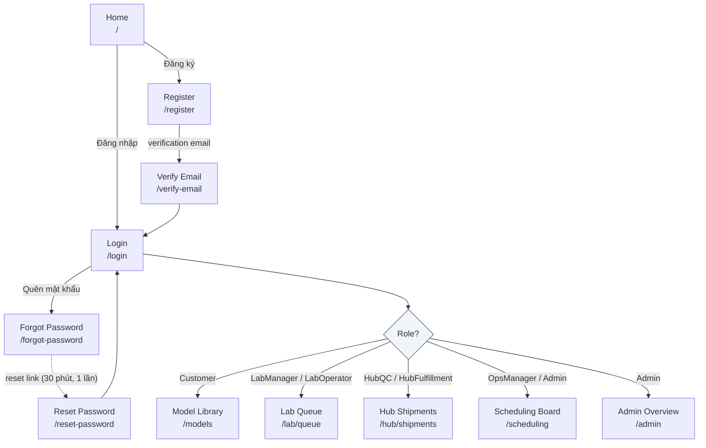
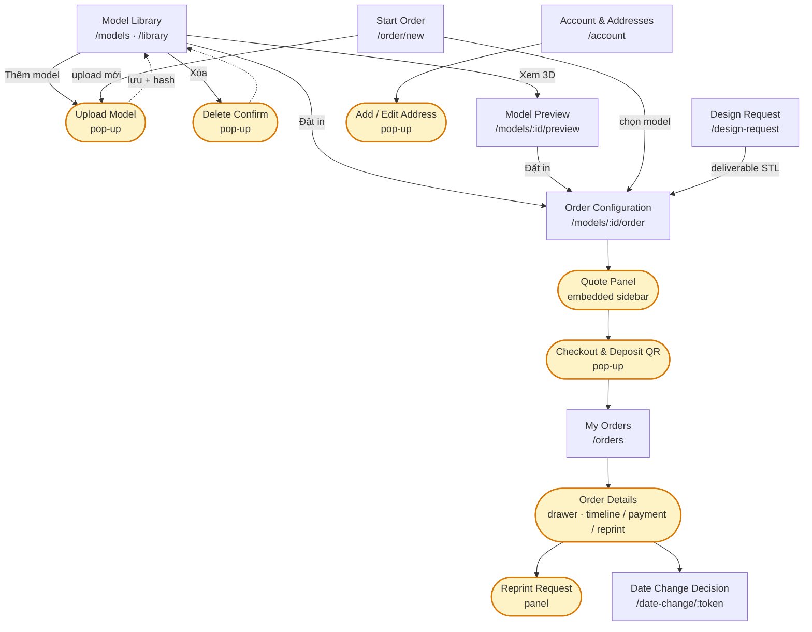
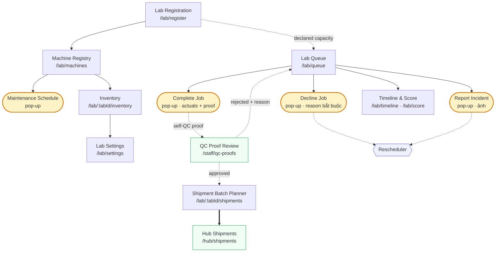
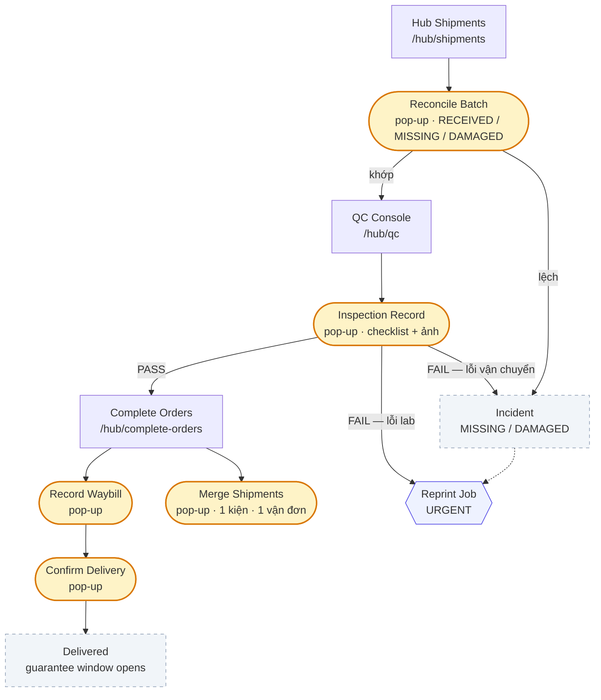
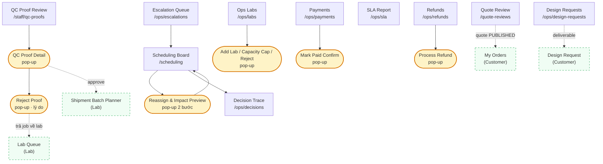
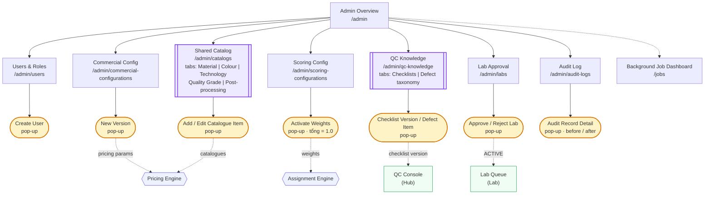

# Report 3 — 3.1.1 Screens Flow (Mermaid, v2 — screen-level)

**Dữ liệu:** `frontend/src/routes/AppRoutes.tsx` + rà trực tiếp các page để xác định pop-up (`<Dialog>`, `<Drawer>`)
và màn nhiều tab (`<Tabs>`). Ngày 28/10/2026.

## Ký hiệu (dùng đúng theo yêu cầu của template)

| Ký hiệu trong sơ đồ | Cú pháp Mermaid | Ý nghĩa |
|---|---|---|
| Chữ nhật | `A["Model Library /models"]` | **Screen phẳng** (flat screen) |
| Oval / bo tròn | `A(["Upload Model pop-up"])` | **Pop-up** (Dialog, Drawer, panel nổi) |
| Chữ nhật viền đôi | `A[["Shared Catalog tabs: … "]]` | **Screen nhiều tab** (multi-tab screen) |
| Lục giác | `A{{"AnalyzeModelJob"}}` | **Xử lý nền** (async worker — không phải màn) |
| Thoi | `A{"Role?"}` | **Điểm rẽ nhánh** (routing / gate) |
| Chữ nhật nền xám, viền đứt | `classDef state` | **Trạng thái kết thúc / outcome** (không phải màn hình) |
| Chữ nhật viền xanh đứt | `classDef cross` | **Màn thuộc portal khác** (node tham chiếu, không vẽ lại) |
| Khung nền màu | `subgraph M01["…"]` | **Phân hệ** (background grouping) |
| Nét đứt `-.->` | `A -.-> B` | Điều hướng **gián tiếp**: qua notification/email, hoặc gọi async |

> **Lưu ý khi đưa vào Word:** template ghi "oval notation" — trong Mermaid hình gần nhất là *stadium*
> (chữ nhật bo tròn hai đầu). Khi vẽ lại bằng Visio/draw.io thì dùng ellipse thật; nếu dùng ảnh Mermaid
> thì ghi chú dưới caption: "oval/stadium = pop-up screen".

---

## Diagram 1 — Overall Screens Flow (hình chính cho mục 3.1.1)

Luồng chính xếp theo **một trục thời gian dọc** (vừa A4 portrait). Vì luồng nghiệp vụ có chu trình
(Quote Review nằm giữa Pricing và Checkout; QC Proof nằm giữa Lab và Shipping), giữ subgraph sẽ luôn
sinh cạnh chéo. Cách xử lý: **bỏ khung subgraph, dùng màu nền để phân biệt phân hệ** — đúng phần
"use background format for different visuality purpose" của template.

**Chú giải màu:** xanh lá = Public/Auth · xanh dương = Customer · chàm = Engine · cam = Ops ·
xanh ngọc = Lab · tím = Hub · vàng + oval = pop-up/drawer · xám viền đứt = trạng thái kết thúc.

**Không vẽ cạnh `Delivered → My Orders`** dù thực tế có cập nhật trạng thái realtime — để tránh một cạnh
kéo ngược từ cuối lên đầu sơ đồ. Ghi chú dưới hình: *"Order status is pushed to `My Orders` in real time
via SignalR (see 3.1.4 #15)."*

---

## Diagram 2 — Public & Authentication

---

## Diagram 3 — Customer Portal (M01), đầy đủ

**Ghi chú:** `Order Details` là **Drawer** (trượt từ phải) chứ không phải route riêng — trong sơ đồ dùng
ký hiệu oval + ghi rõ "drawer". Nội dung drawer gồm 3 khối: timeline, thanh toán cọc/còn lại, yêu cầu in lại.

---

## Diagram 4 — Lab Portal (M02), đầy đủ

---

## Diagram 5 — Hub Console (M03), đầy đủ

---

## Diagram 6 — Operations Console (M05), đầy đủ

---

## Diagram 7 — Administration (M06), có màn nhiều tab

---

## Đối chiếu route ↔ node (tự kiểm tra trước khi nộp)

| Diagram | Screen phẳng | Màn nhiều tab | Pop-up / drawer | Route |
|---|---|---|---|---|
| 2 | 6 | — | — | `/`, `/login`, `/register`, `/verify-email`, `/forgot-password`, `/reset-password` |
| 3 | 9 | — | 7 | `/models`, `/library`, `/models/:id/preview`, `/order/new`, `/models/:id/order`, `/orders`, `/date-change/:token`, `/account`, `/design-request` |
| 4 | 7 | — | 4 | `/lab/queue`, `/lab/register`, `/lab/machines`, `/lab/timeline`, `/lab/score`, `/lab/:labId/inventory`, `/lab/:labId/shipments`, `/lab/settings` |
| 5 | 3 | — | 6 | `/hub/qc`, `/hub/shipments`, `/hub/complete-orders` |
| 6 | 9 | — | 6 | `/quote-reviews`, `/staff/qc-proofs`, `/scheduling`, `/ops/decisions`, `/ops/escalations`, `/ops/labs`, `/ops/sla`, `/ops/payments`, `/ops/refunds`, `/ops/design-requests` |
| 7 | 9 | **2** | 7 | `/admin`, `/admin/users`, `/admin/catalogs`, `/admin/commercial-configurations`, `/admin/scoring-configurations`, `/admin/qc-knowledge`, `/admin/labs`, `/admin/audit-logs`, `/jobs` |
| — | 2 | — | — | `/forbidden`, `*` (404) |

**45 route · 2 màn nhiều tab · 30 pop-up/drawer** — tất cả đều tồn tại trong code,
không có node hư cấu.

> **Còn thiếu (chưa code):** `/samples`, `/pricing`, `/network` — 3 màn public đang chờ duyệt
> FR-CUST-014..016 (`workbook/07b_De-xuat-FR-Customer-Portal.md`). Nếu GVHD duyệt thì thêm 3 node
> nét đứt vào Diagram 1 với nhãn "planned".

---

## Cách export & chèn vào Word

1. Dán **Diagram 1** vào [mermaid.live](https://mermaid.live) → Actions → *PNG (300 dpi, transparent)*.
   Đặt làm **Hình 3.1 – System Screens Flow**. Sơ đồ đã ở bố cục dọc (`flowchart TB`) cho khổ A4 portrait;
   nếu muốn trải ngang A3 thì đổi thành `flowchart LR`.
2. Export Diagram 2–7 riêng, đặt ở phụ lục hoặc thay thế Hình 3.1 nếu GVHD yêu cầu tách theo portal.
3. Dưới mỗi hình thêm chú giải ký hiệu (copy bảng "Ký hiệu" ở đầu file) — template yêu cầu rõ
   "oval notation for pop-up", nên phải có legend để người đọc hiểu.
4. Ảnh chụp màn hình thật (nếu có) nên đặt cạnh từng diagram để đối chiếu, không thay thế diagram.
