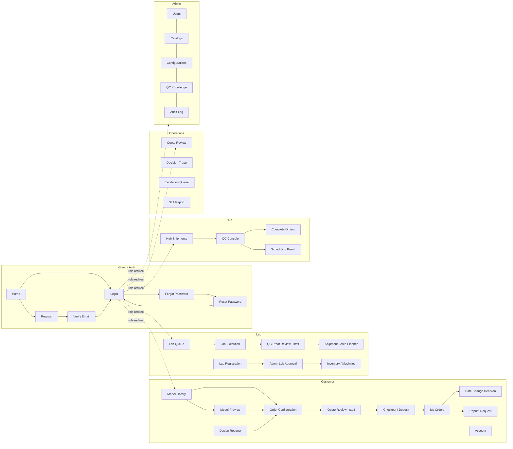

# Report 3 — Section 3. Functional Requirements (DRAFT for PrintGrid)

> **Cách dùng tài liệu này**
> - Phần tiếng Anh là nội dung **copy thẳng vào Word** (Report 3 template đang dùng tiếng Anh).
> - Phần `> NOTE` tiếng Việt là hướng dẫn cho nhóm, **không copy vào report**.
> - Mọi số liệu (route, role, job, trọng số, entity) lấy từ code và tài liệu trong repo ngày 27/10/2026.
> - Nguồn đối chiếu: `documentation/project/requirements/09-Functional-Requirements.md`,
>   `12-Use-Cases.md`, `design/16-Database-ERD.md`, `frontend/src/routes/AppRoutes.tsx`,
>   `src/PrintGrid.Api/{Roles.cs, Program.cs, BackgroundJobs}`.

---

## 3. Functional Requirements

### 3.1 System Functional Overview

PrintGrid is a marketplace platform that turns a customer's 3D model into a delivered part. It exposes six
functional areas over one shared domain model:

| Code | Subsystem | Primary actors | Responsibility |
|------|-----------|----------------|----------------|
| M01 | Customer Experience | Customer | Upload/configure/quote/pay/track, model library, reprint, design request |
| M02 | Lab Operations | Lab Manager, Lab Operator | Onboarding, machines, inventory, job execution, hand-off batches |
| M03 | Hub QC & Fulfilment | Hub QC Staff, Hub Fulfilment Staff | Receipt & reconcile, inspection, consolidation, packing, shipping |
| M04 | Pricing, Assignment & Scheduling Engine ★ | System (engine) | Geometry analysis, pricing, feasibility filtering, scoring, placement, rescheduling, calibration |
| M05 | Operations & Analytics | Operations Manager | Quote approval, QC-proof approval, monitoring, override, SLA reporting, refunds |
| M06 | Platform Administration | System Administrator | Users/roles, catalogues, configuration, QC knowledge, audit |

M04 is the distinguishing subsystem of the project: the other five are conventional CRUD consoles around it.

---

### 3.1.1 Screens Flow

> **NOTE — việc nhóm phải làm:** mục này bắt buộc là **hình**. Đừng dán bảng vào Word.
> Vẽ 6 swimlane (mỗi lane = 1 phân hệ ở bảng trên) bằng draw.io/Visio, rồi export PNG 300 dpi.
> Dùng danh sách chuyển màn bên dưới làm danh sách node + mũi tên. Quy ước nên ghi ở caption:
> hình chữ nhật = screen thường, bo tròn = pop-up/dialog, nét đứt = màn chỉ admin thấy.

**Flow list (dùng để vẽ):**

**Lane 1 — Guest / Authentication**
1. Home (`/`) → Login (`/login`)
2. Home → Register (`/register`) → Verify Email (`/verify-email`) → Login
3. Login → Forgot Password (`/forgot-password`) → (email link) → Reset Password (`/reset-password`) → Login
4. Login → (role-based redirect) → Customer `/models` · Lab `/lab/queue` · Hub `/hub/qc` · Ops `/scheduling` · Admin `/admin`

**Lane 2 — Customer**
5. Model Library (`/models`) → Model Preview (`/models/:id/preview`) (pop-up/full screen 3D)
6. Model Library → Upload dialog → **async: AnalyzeModelJob** → Preview
7. Preview / Library → Start Order (`/order/new`) **hoặc** "Đặt in" → Order Configuration (`/models/:id/order`)
8. Order Configuration → Quote draft → **Quote Review (staff)** → quote publishes → Checkout (deposit) → Order created
9. My Orders (`/orders`) → Order detail/timeline
10. Order detail → Reprint Request (panel) · Date Change Decision (`/date-change/:token`) from notification link
11. Account (`/account`) → profile / addresses
12. Design Request (`/design-request`) → intake form → order draft (when deliverable ready)

**Lane 3 — Lab**
13. Job offer (notification) → Lab Queue (`/lab/queue`) → Accept / Decline
14. Accept → Job detail → Start → Complete (report actuals + self-QC photo proof) → **QC Proof Review (staff)**
15. Approved → Shipment Batch Planner (`/lab/:labId/shipments`) → seal batch → waybill → IN_TRANSIT
16. Onboarding: Lab Registration (`/lab/register`) → Machine Registry (`/lab/machines`) → Inventory (`/lab/:labId/inventory`) → **Admin Lab Approval (`/admin/labs`)** → ACTIVE
17. Lab Timeline & Score (`/lab/timeline`, `/lab/score`); Lab Settings (`/lab/settings`)

**Lane 4 — Hub**
18. Batch arrives → Hub Shipments (`/hub/shipments`) → Scan batch → RECEIVED / MISSING / DAMAGED
19. → QC Console (`/hub/qc`) → checklist → PASS / FAIL (+ defect + attribution)
20. FAIL → reprint job (auto) hoặc ops escalation
21. PASS-all → Complete Orders (`/hub/complete-orders`) → pack gate → waybill → SHIPPED → DELIVERED

**Lane 5 — Operations**
22. Quote Review (`/quote-reviews`) → approve / adjust within band / reject
23. QC Proof Review (`/staff/qc-proofs`) → approve / reject
24. Scheduling Board (`/scheduling`) ← engine assignments; → Decision Trace (`/ops/decisions`)
25. Escalation Queue (`/ops/escalations`); Ops Labs (`/ops/labs`); SLA Report (`/ops/sla`); Payments (`/ops/payments`); Refunds (`/ops/refunds`); Design Requests (`/ops/design-requests`)

**Lane 6 — Administration**
26. Admin Overview (`/admin`) → Users (`/admin/users`) · Catalogs (`/admin/catalogs`) · Commercial Config (`/admin/commercial-configurations`) · Scoring Config (`/admin/scoring-configurations`) · QC Knowledge (`/admin/qc-knowledge`) · Lab Approval (`/admin/labs`) · Audit Log (`/admin/audit-logs`)
27. Error branches: any unauthorized route → Forbidden (`/forbidden`); unknown URL → Not Found (`*`)

**Mermaid source (để tham khảo khi vẽ):**

---

### 3.1.2 Screen Descriptions

> **NOTE:** 45 màn dưới đây là inventory thật từ `AppRoutes.tsx` + `Program.cs`.
> Nếu Word bị dài, gộp các màn admin con thành 1 dòng "Administration Console" và ghi chú 8 tab.

| # | Feature | Screen | Route | Description |
|---|---------|--------|-------|-------------|
| 1 | Public Access | Home Page | `/` | Landing page: value proposition, material/price overview, network statistics (aggregated, no lab identity), entry points to Login/Register. |
| 2 | Authentication | Login | `/login` | Email/password or Google sign-in; on success redirects to the area matching the account's role; shows lockout/verification messages. |
| 3 | Authentication | Register | `/register` | Customer self-registration (name, email, password ≥ 8 chars, T&C acceptance); triggers verification email. |
| 4 | Authentication | Verify Email | `/verify-email` | Confirms the emailed token; unverified accounts cannot place orders. |
| 5 | Authentication | Forgot Password | `/forgot-password` | Accepts an email and always returns the same response (no account-existence disclosure). |
| 6 | Authentication | Reset Password | `/reset-password` | Consumes a one-use token (30-minute expiry) and sets a new password. |
| 7 | Model Management | Model Library | `/models`, `/library` | Grid of the customer's own models with upload, search, delete; shows analysis state (PENDING / ANALYSED / INFEASIBLE) and quota usage. |
| 8 | Model Management | Model Preview | `/models/:modelId/preview` | 3D viewer with rotate/zoom plus bounding-box readout; upload one-click "Đặt in" to configuration. |
| 9 | Account | Account & Addresses | `/account` | Profile edit (with re-authentication for sensitive fields) and address book CRUD; deleting an address in use is blocked. |
| 10 | Ordering | Order Configuration | `/models/:modelId/order` | Per-item print configuration (material, colour, layer height, infill, post-processing, quantity, service level, required-by date) and live quote panel. |
| 11 | Ordering | Start Order | `/order/new` | Hub for starting an order: pick an existing model or upload a new file; routes to Order Configuration. |
| 12 | Design Service | Design Request | `/design-request` | Intake form for customers without a 3D file: description + reference images; shows staged design quote and status. |
| 13 | Order Tracking | My Orders | `/orders` | List of the customer's orders with status, promised delivery date and at-risk badge; drill-down to timeline. |
| 14 | Order Tracking | Date Change Decision | `/date-change/:token` | Customer accepts or rejects a proposed delivery-date change; the decision is recorded with timestamp. |
| 15 | Lab Onboarding | Lab Registration | `/lab/register` | Lab profile, production calendar, capacity declaration and hub transfer time; submitted as PENDING. |
| 16 | Lab Onboarding | Machine Registry | `/lab/machines` | CRUD of machines with full capability spec (technology, build volume, tolerance, materials); delete blocked while active jobs exist. |
| 17 | Lab Onboarding | Inventory | `/lab/:labId/inventory` | Material/colour stock levels, reservations, low-stock alerts and stock-transaction ledger. |
| 18 | Lab Production | Lab Queue | `/lab/queue` | Job offers and accepted jobs with a 2-hour response countdown; accept, decline (reason required), start and complete. |
| 19 | Lab Production | Timeline & Score | `/lab/timeline`, `/lab/score` | Gantt of machine queues and the lab's performance standing with anonymised network comparison. |
| 20 | Lab Production | Shipment Batch Planner | `/lab/:labId/shipments` | Groups proof-approved jobs into a hub-bound run, previews weight and zone allowance, seals the batch and records the waybill. |
| 21 | Lab Production | Lab Settings | `/lab/settings` | Edits the lab's own profile, calendar and capacity; changes are audited as declared-vs-delivered. |
| 22 | Hub Receiving | Hub Shipments | `/hub/shipments` | Expected-batch list; scans a batch QR and reconciles each job as RECEIVED / MISSING / DAMAGED, creating incidents. |
| 23 | Hub QC | QC Console | `/hub/qc` | Runs the grade-bound inspection checklist; records pass/fail, defect class, fault attribution and photo evidence. |
| 24 | Hub Fulfilment | Complete Orders | `/hub/complete-orders` | Consolidates order items, enforces the all-items-PASSED_QC pack gate, prints the packing list, records the waybill and confirms delivery. |
| 25 | Operations | Quote Review | `/quote-reviews` | Operations queue of engine-drafted quotes: inspect price/date/breakdown, adjust within the configured band with a reason, approve or reject. |
| 26 | Operations | QC Proof Review | `/staff/qc-proofs` | Operations queue of lab self-QC photos/reports; approval unlocks lab hand-over, rejection returns the job with a reason. |
| 27 | Operations | Scheduling Board | `/scheduling` | Live board of jobs, machine queues and at-risk orders; shows engine assignments and allows manual intervention. |
| 28 | Operations | Escalation Queue | `/ops/escalations` | Unassigned jobs, reprint-limit breaches and SLA risks requiring a human decision. |
| 29 | Operations | Decision Trace | `/ops/decisions` | Read-only reconstruction of an assignment: candidate labs, per-criterion scores and the configuration version used. |
| 30 | Operations | Ops Labs | `/ops/labs` | Network view of labs: status, capacity, standing; suspend/reactivate a lab. |
| 31 | Operations | SLA Report | `/ops/sla` | Period/scope selection, aggregated on-time, tardiness and per-lab performance, with CSV/PDF export. |
| 32 | Operations | Payments | `/ops/payments` | Pending and settled payment legs (deposit/balance), webhook state and manual reconciliation aid. |
| 33 | Operations | Refunds | `/ops/refunds` | Refund queue with full/partial per item, reason, approval and idempotent gateway execution. |
| 34 | Operations | Design Requests | `/ops/design-requests` | Ops queue for customer design briefs: quote the design stages and track deliverable attachment. |
| 35 | Administration | Admin Overview | `/admin` | Platform KPI landing: users, labs, orders, jobs, failed background jobs. |
| 36 | Administration | User & Role Management | `/admin/users` | CRUD accounts, assign roles, deactivate; self-lockout is blocked and sessions are revoked on role change. |
| 37 | Administration | Shared Catalog | `/admin/catalogs` | Materials, colours, technologies, quality grades and post-processing options; in-use entries can only be deprecated. |
| 38 | Administration | Commercial Configuration | `/admin/commercial-configurations` | Versioned commercial parameters (pricing, deposit %, shipping thresholds, correction bands) with effective date and audit. |
| 39 | Administration | Scoring Configuration | `/admin/scoring-configurations` | Versioned assignment weights (must sum to 1.0) with change reason and impact preview. |
| 40 | Administration | QC Knowledge | `/admin/qc-knowledge` | Versioned inspection checklists and defect taxonomy; referenced codes can only be deprecated. |
| 41 | Administration | Lab Approval | `/admin/labs` | Reviews PENDING labs, approves or rejects with a reason; approval makes the lab selectable by the engine. |
| 42 | Administration | Audit Log | `/admin/audit-logs` | Append-only, filterable audit trail with before/after values; no mutation path exists. |
| 43 | System | Forbidden (403) | `/forbidden` | Shown when an authenticated account opens a route outside its role; offers a link back to its own home. |
| 44 | System | Not Found (404) | `*` | Catch-all page; prevents blank renders on unknown URLs. |
| 45 | Operations (internal) | Background Job Dashboard | `/jobs` | Hangfire dashboard (admin-only) for queue depth, failed jobs and replay. |

---

### 3.1.3 Screen Authorization

> **NOTE — quan trọng:** Report yêu cầu cột theo **role nghiệp vụ**. Dùng đúng 7 role đang có trong
> `Roles.cs`: Customer, LabManager, LabOperator, HubQC, HubFulfillment, OpsManager, Admin — cộng thêm
> Guest (chưa đăng nhập). Việc duyệt báo giá và duyệt QC proof nằm trong policy `RequireQuoteReview`
> mà Operations Manager và Admin cùng giữ, nên **không tách role Order Staff**.
> Nếu bảng quá rộng, đặt section này ở **landscape** hoặc tách 2 bảng.

Legend: `X` = full access · `O` = read-only · `S` = scoped to own data only.

| Screen | Guest | Customer | Lab Manager | Lab Operator | Hub QC | Hub Fulfilment | Ops Manager | Sys Admin |
|--------|:-----:|:--------:|:-----------:|:------------:|:------:|:--------------:|:-----------:|:---------:|
| Home | X | X | X | X | X | X | X | X |
| Login / Register / Verify / Forgot / Reset | X | – | – | – | – | – | – | – |
| Model Library | – | S | – | – | – | – | – | – |
| Model Preview | – | S | – | – | – | – | – | – |
| Account & Addresses | – | S | – | – | – | – | – | – |
| Order Configuration | – | S | – | – | – | – | – | – |
| Start Order | – | S | – | – | – | – | – | – |
| Design Request | – | S | – | – | – | – | – | – |
| My Orders | – | S | – | – | – | – | – | – |
| Date Change Decision | – | S | – | – | – | – | – | – |
| Lab Registration | – | – | S | – | – | – | – | X |
| Machine Registry | – | – | S | – | – | – | – | X |
| Inventory | – | – | S | – | – | – | – | – |
| Lab Queue | – | – | S | S | – | – | – | – |
| Timeline & Score | – | – | S | S | – | – | – | – |
| Shipment Batch Planner | – | – | S | S | – | – | – | – |
| Lab Settings | – | – | S | – | – | – | – | X |
| Hub Shipments | – | – | – | – | X | X | – | – |
| QC Console | – | – | – | – | X | – | – | X |
| Complete Orders | – | – | – | – | X | X | – | – |
| Quote Review | – | – | – | – | – | – | X | X |
| QC Proof Review | – | – | – | – | – | – | X | X |
| Scheduling Board | – | – | – | – | – | – | X | X |
| Escalation Queue | – | – | – | – | – | – | X | X |
| Decision Trace | – | – | – | – | – | – | X | X |
| Ops Labs | – | – | – | – | – | – | X | X |
| SLA Report | – | – | – | – | – | – | X | X |
| Payments | – | – | – | – | – | – | X | X |
| Refunds | – | – | – | – | – | – | X | X |
| Design Requests (ops) | – | – | – | – | – | – | X | X |
| Admin Overview | – | – | – | – | – | – | – | X |
| User & Role Management | – | – | – | – | – | – | – | X |
| Shared Catalog | – | – | – | – | – | – | – | X |
| Commercial Configuration | – | – | – | – | – | – | O | X |
| Scoring Configuration | – | – | – | – | – | – | O | X |
| QC Knowledge | – | – | – | – | – | – | O | X |
| Lab Approval | – | – | – | – | – | – | O | X |
| Audit Log | – | – | – | – | – | – | – | X |
| Background Job Dashboard | – | – | – | – | – | – | – | X |
| Forbidden / Not Found | X | X | X | X | X | X | X | X |

**Screen activities (màn có phân quyền ở mức hành động):**

| Screen | Activity | Allowed role | Rule |
|--------|----------|--------------|------|
| Model Library | Query own data | Customer (S) | Ownership isolation: a customer can never read another customer's model |
| Model Library | Add new data (upload) | Customer | Quota per account; STL/OBJ/3MF ≤ 50 MB; SHA-256 recorded |
| Model Library | Delete own data | Customer | Blocked while a model is referenced by an open order |
| My Orders | Query own data | Customer (S) | No lab name/ID is ever projected into this view |
| My Orders | Query all data | Ops Manager, Sys Admin | Read-only projection, used for support |
| Quote Review | Update (adjust within band) | Operations Manager | Reason mandatory; outside band escalates to Admin |
| Quote Review | Approve / Reject | Operations Manager | Publish starts the quote-expiry clock |
| QC Console | Record inspection | Hub QC | Checklist version pinned to the inspection |
| Complete Orders | Confirm shipment | Hub Fulfilment | Blocked unless every item is PASSED_QC |
| Refunds | Approve refund | Ops Manager | Idempotent by transaction id; daily reconciliation |
| User & Role Management | Create / Update / Deactivate | Sys Admin | Self-lockout blocked; role change revokes sessions |
| Commercial / Scoring Config | Update | Sys Admin | New version only; historical versions immutable |
| Audit Log | Read | Sys Admin | No update/delete path exists |

---

### 3.1.4 Non-Screen Functions

> **NOTE:** Bảng này lấy từ `BackgroundJobs/`, `Program.cs`, các service trong `PrintGrid.Modules.Scheduling`,
> `Hubs/` và `EventHandlers/`. Thông tin kích hoạt (trigger) đã gộp vào đầu câu Description.

| # | Feature | System Function | Description |
|---|---------|-----------------|-------------|
| 1 | Model Pipeline | Geometry analysis worker (`AnalyzeModelJob`) | Runs on model upload: parses the mesh, computes bbox/volume/watertight/manifold, validates against the network's build volumes and stores the analysis with the model. |
| 2 | Model Pipeline | Slicing / estimation service | Called by the analysis pipeline: produces a reference print time and material quantity per machine profile; raw values are stored so a quote is reproducible. |
| 3 | Pricing Engine | Quote computation | Runs synchronously on a quote request: reads the active `PricingParameterSet`, computes material + machine time + post-processing + shipping and **freezes the parameter version onto the quote**. |
| 4 | Scheduling Engine | Speculative placement | Runs on each quote request in a trial sandbox: returns the earliest feasible delivery date and any surcharge against current load; never mutates the real schedule. |
| 5 | Scheduling Engine | Hard feasibility filter | Runs at order placement and assignment: removes labs that fail technology, build volume, tolerance, stock, lab state or standing constraints. |
| 6 | Scheduling Engine | Multi-criteria scoring | Runs after filtering: scores each feasible (lab, machine) pair with the active weight version — due-date slack 0.35 · lab reliability 0.25 · load balance 0.20 · cost 0.10 · transit 0.10 (weights must total 1.0). |
| 7 | Scheduling Engine | Job decomposition & machine placement | Runs after selection: splits an order into jobs, places them on machine queues with backward-computed internal due dates and sets the job offer window (2 h). |
| 8 | Scheduling Engine | Assignment decision log | Runs on every assignment: persists the candidate set, per-criterion scores and the configuration version so any assignment can be reconstructed. |
| 9 | Scheduling Engine | Event-driven rescheduling | Triggered by domain events — lab decline, print failure, machine breakdown, reprint, in-transit damage: locks in-progress jobs, repairs the unstarted plan within the time budget, keeps a committed fallback and applies the preference order split-quantity → reassign → propose date change. |
| 10 | Scheduling Engine | Reprint job creation | Triggered by an inspection FAIL with non-customer attribution: creates an URGENT reprint that inherits the original deadline, enforces the 2-reprint limit and escalates beyond it. |
| 11 | Notification | Email outbox delivery (`EmailDeliveryJob`) | Hangfire recurring job running every minute (`Cron.Minutely()`): flushes the durable outbox — upload receipt (time/size/hash), verification, password reset, status alerts. Retries are idempotent. |
| 12 | Estimation | Nightly calibration (`CalibrationNightlyJob`) | Hangfire recurring job running daily at 02:17 (`17 2 * * *`): collects (estimated, actual) pairs per machine model and refits correction factors so future quotes and schedules converge to reality. |
| 13 | Payments | Payment webhook receiver | Called by the external gateway: verifies the signature, is validated idempotently by transaction id, and only a verified webhook plus the order-confirmation API call may commit an order. |
| 14 | Payments | Daily reconciliation | Scheduled daily (T-1): compares gateway settlement against recorded transaction state; a mismatch auto-freezes the transaction for manual review. |
| 15 | Realtime | Status notification publisher | Triggered by domain events and pushed through `OrderHub` / `LabHub` (SignalR): updates order timelines and job offers to the right audience; customer payloads never contain lab identity. |
| 16 | Security | Audit trail writer | Runs on every mutation via an EF Core interceptor: emits an append-only record with actor, action, entity, before/after and correlation id. |
| 17 | Storage | Secure file storage | Runs on upload and download requests: stores models under a per-customer key and issues time-limited download links to labs only while a job is active. |
| 18 | Research | Network simulation harness | Started manually by an authorised evaluator: order generator + fault injection driving the real engines in simulation mode, exporting reproducible metrics for the evaluation report. |

> **Ghi chú hiện trạng (nội bộ, không copy vào Word):** #14 Daily reconciliation đang ở mức
> *partial / runbook*; #18 Network simulation harness mới ở mức *specified* — đừng mô tả hai mục này
> như đã hoàn thiện nếu hội đồng đối chiếu demo.

---

### 3.1.5 Entity Relationship Diagram

> **NOTE:** Nếu Word cần hình, dán ERD export từ `documentation/project/design/16-Database-ERD.md`
> (mermaid `erDiagram`) hoặc vẽ lại bằng draw.io. **Kiểm tra trước khi nộp:** ERD trong tài liệu thiết kế
> có vài entity (`User`, `InspectionResult`, `Shipment`, `Payment`) chưa tồn tại thành bảng riêng trong
> migration hiện tại — schema thật gồm 28 bảng. Nếu GVHD đối chiếu code, hoặc sửa ERD theo migration,
> hoặc ghi rõ "logical model; physical schema in Appendix". Tôi có thể sinh ERD từ migration nếu bạn muốn.

**Entities Description**

| # | Entity | Schema | Description |
|---|--------|--------|-------------|
| 1 | Customer | customer | Account holder with profile and credentials; owns models, quotes and orders. |
| 2 | CustomerAddress | customer | Saved delivery addresses; deletion blocked while referenced by an open order. |
| 3 | Model | customer | Uploaded 3D file: storage key, SHA-256 hash, size, format, analysis state and geometry result. |
| 4 | Quote | customer | Priced offer: total, JSON breakdown, promised delivery date, expiry and the frozen pricing-parameter version. |
| 5 | QuoteItem | customer | One configured item inside a quote (model, configuration, quantity, unit price). |
| 6 | Order | customer | Committed purchase: status, delivery address, promised date, payment state. |
| 7 | OrderItem | customer | One item inside an order; becomes one or more jobs. |
| 8 | DesignRequest | customer | Customer brief without a file: description, reference images, staged design quote, deliverable reference. |
| 9 | ReprintRequest | customer | Post-delivery complaint with photos and guarantee-window check. |
| 10 | RefundRequest | customer | Full/partial refund case with reason, approval and gateway execution state. |
| 11 | Lab | scheduling | Partner print shop: location, transfer time, declared calendar, status (PENDING/ACTIVE/SUSPENDED) and performance standing. |
| 12 | Machine | scheduling | Print capability: technology, build volume, tolerance, supported materials, status, hourly rate. |
| 13 | MaterialStock | scheduling | Declared stock per material/colour at a lab, with reservation and tolerance. |
| 14 | MaterialReservation | scheduling | Quantity reserved when a job is accepted and settled against actuals on completion. |
| 15 | StockTransaction | scheduling | Immutable stock movement (in/out/adjust) with a transaction code and running total. |
| 16 | Job | scheduling | Smallest schedulable unit: assigned lab/machine, queue position, internal due date, state, estimated vs actual time and material. |
| 17 | AssignmentDecision | scheduling | Decision log: candidate set, per-criterion scores, selected pair and configuration version. |
| 18 | CalibrationSample | scheduling | One (estimated, actual) pair per completed job, feeding the nightly correction factors. |
| 19 | DateChangeRequest | scheduling | Proposed delivery-date change with its consent token, customer decision and timestamp. |
| 20 | ShipmentBatch | scheduling | Lab→hub run: grouped proof-approved jobs, weight, zone allowance, waybill and status. |
| 21 | OpsEscalation | scheduling | Human-decision queue item (no feasible lab, reprint limit, SLA breach). |
| 22 | ScoringWeightConfiguration | scheduling | Versioned assignment weights with change reason and effective date. |
| 23 | InspectionChecklistVersion | admin | Versioned, grade-bound checklist definition used by QC. |
| 24 | DefectTaxonomyItem | admin | Defect code/class; deletable only while unreferenced, otherwise deprecated. |
| 25 | SharedCatalogItem | admin | Materials, colours, technologies, quality grades and post-processing options. |
| 26 | CommercialConfigurationVersion | admin | Versioned commercial parameters (pricing inputs, deposit %, shipping thresholds, review bands). |
| 27 | AuditLog | admin | Append-only security/business audit trail with before/after values. |
| 28 | EmailOutbox | infrastructure | Durable outbound-email queue drained by the recurring delivery job. |

**Key relationships**

- `Customer 1—N Order`; `Order 1—1 Quote` (derived from); `Order 1—N OrderItem`; `OrderItem 1—N Job`
- `Lab 1—N Machine`; `Lab 1—N MaterialStock`; `Job N—1 Machine`; `Job N—1 Lab`
- `Job 1—N AssignmentDecision`; `Job 1—N CalibrationSample`
- `ShipmentBatch 1—N Job`; `InspectionChecklistVersion 1—N (inspection)`
- `Order 1—N ShipmentBatch` via packing/consolidation

---

## 3.2 Customer Ordering & Account

> **⚠️ ĐÃ THAY THẾ — không dùng phần dưới khi nộp.** Toàn bộ 3.2–3.7 nay nằm trong
> **[Report3_Section3.2-3.7_Feature-Specifications.md](Report3_Section3.2-3.7_Feature-Specifications.md)**
> (6 feature · 36 function · mỗi function đủ 4 phần). Phần dưới chỉ giữ làm bản nháp tham khảo;
> lưu ý **đánh số khác**: bản cũ 3.3 = Engine, bản mới 3.3 = Lab Operations.
>
> **NOTE — cách chia 3.2 / 3.3 / …:** Template chỉ có 2 slot `<<Feature Name 1>>` và `<<Feature Name 2>>`,
> nhưng đó là placeholder. Với 6 phân hệ, cách trình bày gọn nhất:
> **3.2 Customer Ordering & Account · 3.3 Lab Operations · 3.4 Hub Quality & Fulfilment ·
> 3.5 Pricing, Assignment & Scheduling Engine ★ · 3.6 Operations & Analytics · 3.7 Platform Administration.**
> Nếu GVHD bắt đúng 2 mục: 3.2 = "Order-to-Delivery Chain" (Customer + Lab + Hub), 3.3 = "Engine & Platform
> Governance" (Engine + Ops + Admin). Mỗi feature phải có **ít nhất 1 function được đặc tả đầy đủ 4 phần**
> (trigger / description / screen layout / details); các function còn lại có thể ở mức bảng.

**Functions in this feature**

| Function | Type | FR |
|----------|------|----|
| Register / Sign in / Recover password | Screen | FR-CUST-001 |
| Upload model + hash receipt | Screen + async worker | FR-CUST-002 |
| 3D preview + bbox | Screen | FR-CUST-003 |
| Validation feedback | Screen + engine | FR-CUST-004 |
| Print configuration | Screen | FR-CUST-005 |
| Automatic quote | Screen + engine | FR-CUST-006, FR-SCHED-010 |
| Confirm quote → order | Screen | FR-CUST-007 |
| Deposit / balance payment | Screen + webhook | FR-CUST-008, FR-CUST-012 |
| Track order | Screen + SignalR | FR-CUST-009 |
| Model library & reorder | Screen | FR-CUST-010 |
| Reprint / complaint | Screen | FR-CUST-011 |
| Design request | Screen | FR-CUST-013 |

### 3.2.1 Configure and Place an Order (UC-001)

**Function trigger**
Navigation: `Model Library (/models)` → select a model → **"Đặt in"**, which opens
`Order Configuration (/models/:modelId/order)`; or `Start Order (/order/new)` → upload → configure.
The function ends at checkout, which is triggered by the **"Xác nhận & thanh toán cọc"** button.

**Function description**
- **Actors:** Customer (primary); Pricing Engine and Scheduling Engine (secondary, system); Payment Gateway
  and Quote Review staff (secondary, human/external).
- **Purpose:** Turn a validated 3D model plus a print configuration into a priced, date-committed order
  whose production can start immediately after the deposit is verified.
- **Interface:** Customer Portal (web, responsive ≥ 360 px); REST `POST /quotes`, `POST /orders`,
  `POST /orders/{id}/payments`; SignalR `OrderHub` for subsequent status.
- **Data processing:**
  1. Load the model and its stored analysis; block if state is `INFEASIBLE`.
  2. Customer edits the configuration; each change invalidates the previous quote.
  3. On "Get quote", the system sends model + configuration to the Pricing Engine, which freezes the active
     parameter version, and to the Scheduling Engine, which runs a **speculative placement** to derive the
     earliest feasible delivery date.
  4. The quote is persisted as `DRAFT`; it becomes `PUBLISHED` after staff approval (or immediately on the
     auto-lane when the deviation is under the configured threshold) and only then starts its expiry clock.
  5. On checkout the customer supplies/selects a delivery address and accepts the terms; the quote converts
     to an `Order` in a single transaction.
  6. The deposit QR is issued; **only** a verified gateway webhook plus the order-confirmation call moves the
     order to `PAID` and triggers assignment (UC-011).

**Screen layout**
> **NOTE:** chèn mock-up/wireframe ở đây. Nên chụp từ Figma hoặc screenshot thật, gồm 3 vùng:
> (A) trái: 3D viewer + kích thước bbox; (B) giữa: form cấu hình theo nhóm; (C) phải: panel báo giá dính
> (sticky) với breakdown, ngày giao, đồng hồ hết hạn và nút checkout.

**Function details**

| Field | Control | Validation / rule |
|-------|---------|-------------------|
| Material | Select | Only materials available in the active catalogue; invalid with current technology → disabled with reason (BR-CONFIG-003) |
| Colour | Select | Filtered by material; out-of-stock colour disabled |
| Layer height | Select (mm) | Allowed set per machine profile; affects time and price |
| Infill | Slider/Select (%) | 0–100 in steps defined by configuration |
| Post-processing | Multi-select | Each option has its own lead time added to the due-date computation |
| Quantity | Number | ≥ 1; a multi-quantity item may be split across capable labs at an unchanged unit price (BR-SCHED-010) |
| Service level | Select | Standard / Express; Express may add a surcharge and a tighter promise |
| Required-by date | Date | Must be ≥ earliest feasible date returned by speculative placement |
| Delivery address | Select + "add new" | Mandatory at checkout; address in use cannot be deleted |
| Terms | Checkbox | Mandatory before order creation |

**Business rules**
- BR-QUOTE-001..006: one formula, one active parameter set, frozen version, breakdown sums to total.
- BR-LOG-004: shipping is an explicit line in the breakdown.
- BR-QUOTE-008: a quote is customer-visible only after approval; expiry starts at approval, not at generation.
- BR-CONFIG-003: invalid option combinations are disabled, never silently substituted.
- BR-SCHED-010: splitting quantity never changes the customer's price.

**Normal case**
Upload → analysis → configure → quote draft → staff/auto approval → customer sees quote and date → checkout
→ deposit verified → order `PAID` → jobs assigned → confirmation email.

**Abnormal cases**
| Condition | System behaviour |
|-----------|------------------|
| Model not watertight / oversize | Validation panel lists issues per item; quote button disabled (FR-CUST-004) |
| No feasible lab for the requested date | Quote is refused with the earliest feasible date offered instead |
| Quote expires before checkout | Checkout blocked; a fresh quote is required (BR-QUOTE-003) |
| Payment webhook not verified within the QR window | Order stays `PAYMENT_PENDING`; no production starts |
| Customer closes the tab mid-configuration | Draft configuration persists and is restored on return |

---

## 3.3 Pricing, Assignment & Scheduling Engine ★ (core contribution)

> Đây là phân hệ nên được đặc tả **dày nhất** vì là đóng góp chính của đề tài và là phần hội đồng sẽ hỏi.
> Nếu thời gian eo hẹp, giữ 3.2.1 và 3.3.1 ở mức đầy đủ, các mục còn lại dùng bảng.

**Functions in this feature**

| Function | Type | FR |
|----------|------|----|
| Geometry analysis | Non-screen worker | FR-SCHED-001 |
| Slicing / time & material estimate | Non-screen service | FR-SCHED-002 |
| Pricing computation + parameter freeze | Non-screen service | FR-SCHED-010 |
| Speculative placement at quote time | Non-screen service | FR-SCHED-005 |
| Hard feasibility filter | Non-screen | FR-SCHED-003 |
| Multi-criteria scoring | Non-screen | FR-SCHED-004 |
| Job decomposition & machine placement | Non-screen | FR-SCHED-006 |
| Assignment decision log | Non-screen | FR-SCHED-009 |
| Event-driven rescheduling | Non-screen | FR-SCHED-007 |
| Reprint job creation | Non-screen | FR-HUB-003 |
| Estimation calibration | Non-screen nightly job | FR-SCHED-008 |

### 3.3.1 Automatic Job Assignment (UC-011)

**Function trigger**
Triggered automatically when an order reaches `PAID` (deposit verified), by the internal call
`POST /scheduling/assign`, and re-entered by the rescheduler when a repair is required. It can also be
invoked manually by Operations from the Scheduling Board.

**Function description**
- **Actors:** Scheduling Engine (primary, system); Lab Manager (secondary, receives the offer);
  Operations Manager (secondary, handles escalation).
- **Purpose:** Choose, for every job, the (lab, machine) pair that best satisfies the delivery promise while
  remaining feasible, and make that choice fully reconstructible.
- **Interface:** internal REST/service call; emits `JobAssigned`; pushes an offer to `LabHub`; writes
  `AssignmentDecision`.
- **Data processing:**
  1. Load the job, its required configuration and the candidate lab/machine set.
  2. Apply the **hard feasibility filter** (technology, build volume, tolerance, material stock, lab status,
     lab standing). Infeasible pairs are discarded and never scored.
  3. Compute a normalised score in [0, 1] for each remaining pair:
     `score = 0.35·slack + 0.25·reliability + 0.20·loadBalance + 0.10·cost + 0.10·transit`
     using the configuration version that is active at assignment time.
  4. Select the highest score; break ties deterministically by lab id.
  5. Decompose multi-quantity items into jobs, compute the internal due date backwards from the promised
     delivery date (print + post-processing + transfer must fit), and place the job on the machine queue.
  6. Persist the decision log (candidates, scores, version) **before** publishing the assignment; if the log
     write fails, the assignment is rolled back.
  7. Publish `JobAssigned`, notify the lab and start the 2-hour offer window.

**Screen layout**
> **NOTE:** đây là function non-screen, nhưng Report yêu cầu "screen layout". Cách xử lý đúng:
> ghi "No dedicated screen — output is rendered on two screens" rồi chèn 2 ảnh:
> (a) **Scheduling Board** `/scheduling` — job đã gán nằm trên queue của máy;
> (b) **Decision Trace** `/ops/decisions` — bảng candidate + điểm từng tiêu chí.

**Function details**

*Hard constraints (any failure ⇒ not a candidate)*
| Constraint | Source |
|------------|--------|
| Technology matches the configured process | Machine capability |
| Part fits the build volume incl. orientation margin | Machine + analysis |
| Achievable tolerance ≥ required tolerance | Machine |
| Material and colour stock ≥ reserved quantity | MaterialStock + reservation |
| Lab status = ACTIVE | Lab |
| Lab standing above the configured floor | Standing metric |

*Scoring criteria*
| Criterion | Weight | Meaning |
|-----------|--------|---------|
| Due-date slack | 0.35 | How much buffer remains if this lab takes the job |
| Lab reliability | 0.25 | On-time and first-pass yield history |
| Load balance | 0.20 | Avoids overloading one lab |
| Cost | 0.10 | Production cost to the platform |
| Transit | 0.10 | Lab→hub transfer time |

Weights are a versioned configuration; a new version must total exactly 1.0 (FR-ADMIN-002).

**Normal case**
Paid order → filter → score → best pair selected → jobs placed with internal due dates → decision logged →
lab notified with a 2-hour window → lab accepts → job enters the machine queue.

**Abnormal cases**
| Condition | System behaviour |
|-----------|------------------|
| No feasible lab | Job is escalated to Operations (`OpsEscalation`); the customer's promise is not silently changed |
| Lab declines or the 2-hour window expires | `JobDeclined` → rescheduler repairs the plan (UC-012) |
| Print failure / machine breakdown | Rescheduler locks in-progress jobs and repairs the remaining plan within the time budget |
| Log write fails | Assignment is rolled back; no unlogged assignment exists |
| Two jobs race for the last capacity | Placement is serialised per machine; the concurrency test expects zero double-booking |

---

## 3.4 – 3.7 Remaining features (condensed)

> **NOTE:** dùng cùng form 4 phần nhưng ở mức ngắn. Mỗi mục nên có: bảng function → FR, 1 screenshot,
> và 3–5 business rules. Không cần lặp lại cấu trúc dài.

**3.4 Lab Operations** — onboarding (registration, machines, inventory), job acceptance, shop-floor
execution, self-QC proof, hand-over batch, timeline and standing. *Key rules:* 2-hour offer window;
reserve-on-accept / settle-with-actuals stock; hand-over blocked until QC proof is approved.

**3.5 Hub Quality & Fulfilment** — batch receipt and reconciliation, checklist inspection with defect
attribution, reprint creation, consolidation and the pack gate (every item must be PASSED_QC), waybill and
delivery confirmation that opens the 30-day guarantee window.

**3.6 Operations & Analytics** — quote review workbench, QC-proof approval, network monitoring, at-risk
orders, manual override with impact preview, SLA reports and export, refunds with reconciliation.

**3.7 Platform Administration** — users/roles, shared catalogues, commercial and scoring configuration
(versioned, no redeploy), QC knowledge base, lab approval, append-only audit log and background-job health.

---

## Phụ lục — Checklist trước khi nộp

- [ ] Hình **Screens Flow** đã export PNG 300 dpi, có caption + số hình.
- [ ] Hình **ERD** khớp với schema thật (hoặc có ghi chú logical vs physical).
- [ ] Mock-up/screenshot cho **mọi function được đặc tả đầy đủ** ở 3.2–3.7.
- [ ] Tên role trong 3.1.3 thống nhất với 3.1.2 và với `Roles.cs` (7 role + Guest).
- [ ] Mỗi FR trong `09-Functional-Requirements.md` xuất hiện ở **ít nhất một** mục 3.x.y.
- [ ] Số hiệu mục khớp TOC của Word (bấm Update Field).
- [ ] Sửa lỗi template: mục 3.2 đang ghi "listed in part 3.1.5" — đúng phải là **3.1.4**.
- [ ] Record of Changes có ít nhất 1 dòng (ngày, M, người phụ trách, mô tả).
