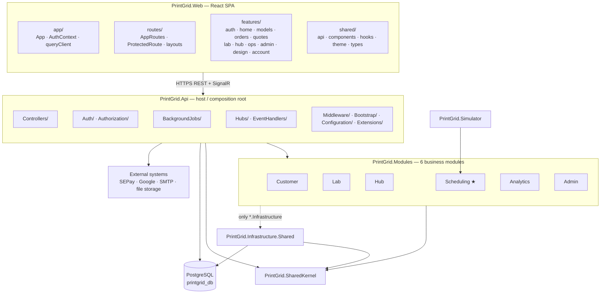
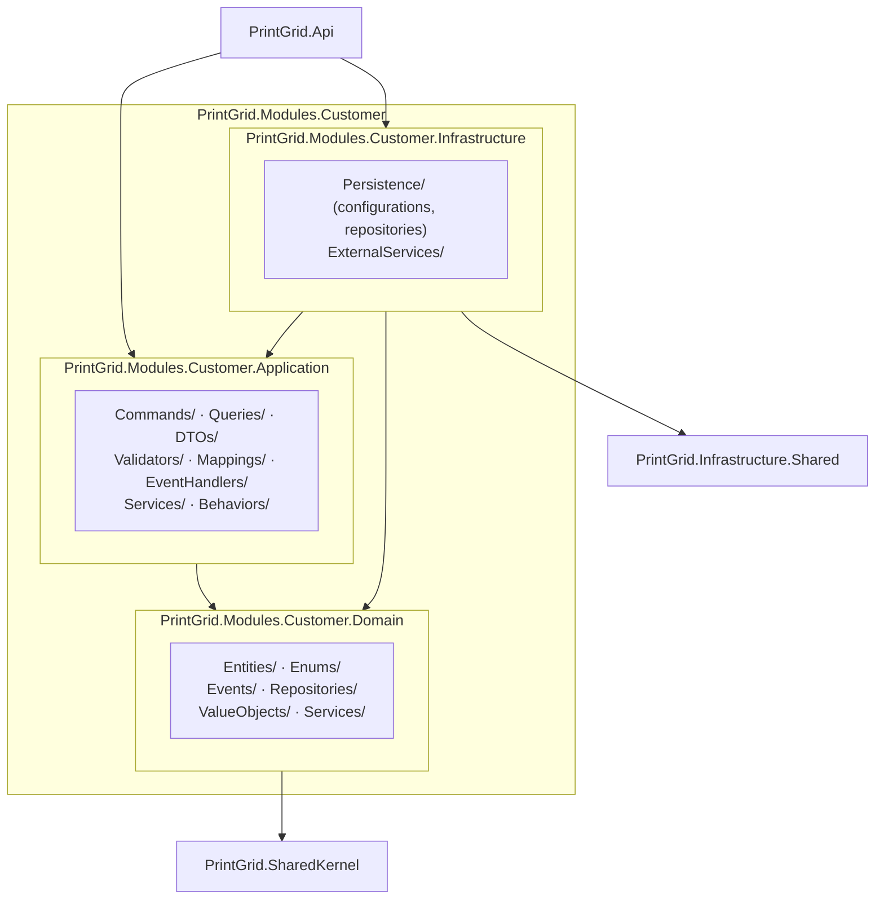
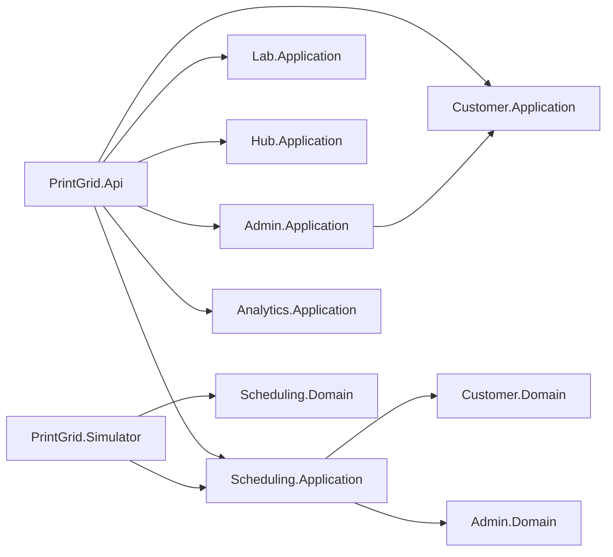
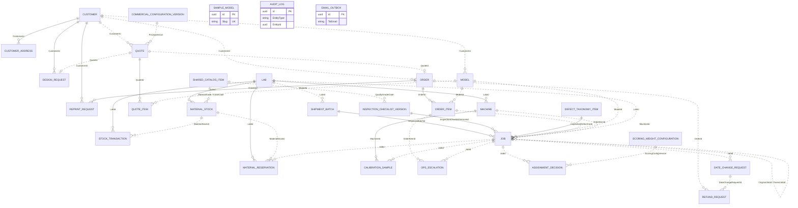

# Report 4 — 1.2 Package Diagram & 2. Database Design (PrintGrid)

**Nguồn:** `PrintGrid.sln`, các file `.csproj` (dependency thật giữa project), cấu trúc thư mục
`src/*` và `frontend/src/*`, `PrintGridDbContextModelSnapshot.cs` (schema cuối, **29 bảng**, 28/10/2026).

> **Cập nhật so với Report 3:** từ 28/10 có thêm migration `AddSampleLibrary` → bảng `admin.sample_models`.
> Nếu Report 3 mục 3.1.5 đã nộp bản 28 bảng, cần bổ sung bảng này cho khớp (xem §2.3 #29).

---

# 1.2 Package Diagram

## 1.2.1 Overall package diagram

**Đọc sơ đồ:** `PrintGrid.Api` là composition root duy nhất — nó tham chiếu *cả* `Application` và
`Infrastructure` của 6 module. Module không tham chiếu `Api`. Chỉ lớp `Infrastructure` của module chạm
`PrintGrid.Infrastructure.Shared` (persistence, outbox, storage); `Domain` và `Application` không.

## 1.2.2 Layer packages inside one module (representative)

Tất cả 6 module có cùng hình dạng; vẽ một cái rồi ghi chú "Customer thay bằng Lab / Hub / Scheduling /
Admin / Analytics".

## 1.2.3 Cross-module dependencies (thực tế từ .csproj)

Hai phụ thuộc chéo cần giải thích khi bảo vệ (đây là **sự thật trong code**, không phải vẽ sai):

| Phụ thuộc | Dùng để làm gì | Cách trình bày |
|---|---|---|
| `Scheduling.Application → Customer.Domain` | Đọc repository/entity của đơn hàng để tính giá và xếp lịch mà không nhân bản model | "Scheduling consumes the Customer domain contracts; the dependency is one-directional." |
| `Scheduling.Application → Admin.Domain` | Đọc cấu hình thương mại và checklist/defect | Như trên |
| `Admin.Application → Customer.Application` | Dùng kiểu quote/pricing khi quản trị cấu hình | "Admin reuses the quoting contracts; no reverse dependency exists." |

> Nếu hội đồng hỏi "sao không tách SharedKernel": trả lời đây là modular monolith chạy in-process, các
> phụ thuộc chỉ ở mức type/contract và một chiều; hướng refactor là đưa các contract dùng chung
> (`Money`, id types, `IQuoteReader`) vào `SharedKernel`, đã ghi ở phần future work.

## 1.2.4 Package Descriptions

| No | Package | Description |
|----|---------|-------------|
| 01 | `PrintGrid.Web` | React 18 + TypeScript SPA (Vite). Composition root of the client: `app/` boots the app, holds `AuthContext` and the React Query client. |
| 02 | `PrintGrid.Web.routes` | Route table and guards: `AppRoutes`, `ProtectedRoute`, `CustomerLayout`, `StaffLayout`, `AdminLayout`. Maps URL → feature screen and enforces role-based access. |
| 03 | `PrintGrid.Web.features` | One folder per business area (`auth`, `home`, `models`, `orders`, `quotes`, `lab`, `hub`, `ops`, `admin`, `design`, `account`, `scheduling`, `qcProof`). Owns screens, hooks and local types. |
| 04 | `PrintGrid.Web.shared` | Cross-feature building blocks: typed API client, shared components, hooks, MUI theme, shared types. No business rules. |
| 05 | `PrintGrid.Api` | ASP.NET Core host and composition root. Wires DI, auth, Hangfire, SignalR, Swagger, module registrations and the middleware pipeline. |
| 06 | `PrintGrid.Api.Controllers` | REST endpoints grouped by area (Auth, Models, Quotes, Orders, Jobs, Labs, Hub, Ops, Admin, Refunds, SLA, Calibration). Thin: validate → send MediatR → map result. |
| 07 | `PrintGrid.Api.Auth` / `.Authorization` | JWT issuing/validation (`JwtTokenService`), password hashing, role constants (`Roles`) and authorization policies (`RequireCustomer`, `RequireLab`, `RequireHub`, `RequireOps`, `RequireAdmin`, `RequireQuoteReview`, `RequireProduction`). |
| 08 | `PrintGrid.Api.BackgroundJobs` | Hangfire entry points: `AnalyzeModelJob` (on upload), `EmailDeliveryJob` (every minute), `CalibrationNightlyJob` (02:17 daily). Thin wrappers; rules live in Application handlers. |
| 09 | `PrintGrid.Api.Hubs` / `.EventHandlers` | SignalR hubs (`OrderHub`, `LabHub`) and integration-event handlers that push timeline/offer updates to the right audience. |
| 10 | `PrintGrid.Api.Middleware` · `.Bootstrap` · `.Configuration` · `.Extensions` | Cross-cutting infrastructure: exception handling, correlation/trace id, module assembly registry, options binding, endpoint and DI extensions. |
| 11 | `PrintGrid.SharedKernel` | Framework-free primitives shared by every module: `Entity`/`AggregateRoot`, `Result`/`Error`, value objects (`Money`), domain event contracts, repository/UoW interfaces, clock abstraction. |
| 12 | `PrintGrid.Infrastructure.Shared` | Technical implementations reused by module infrastructure: EF Core `PrintGridDbContext`, unit of work, migrations, email outbox, file storage, caching, time provider. |
| 13 | `…Infrastructure.Shared.Persistence` | `PrintGridDbContext`, `ModuleAssemblyRegistry`, `UnitOfWork` and the entire migration history (single database, schema-per-module). |
| 14 | `…Infrastructure.Shared.Outbox` | `email_outbox` store and dispatcher contract — durable, retried email delivery decoupled from request latency. |
| 15 | `PrintGrid.Modules.Customer.Domain` | Customer aggregate, addresses, models, quotes, orders, reprint/refund/design requests; enums, value objects, domain events and repository contracts. |
| 16 | `PrintGrid.Modules.Customer.Application` | CQRS handlers for auth, models, quotes, orders, payments, addresses, design requests; FluentValidation validators; DTOs/mappings. |
| 17 | `PrintGrid.Modules.Customer.Infrastructure` | EF configurations and repositories for the `customer` schema; external adapters (file storage, token generation). |
| 18 | `PrintGrid.Modules.Scheduling.Domain` ★ | Job, Lab, Machine, MaterialStock/Reservation/Transaction, AssignmentDecision, CalibrationSample, ShipmentBatch, DateChangeRequest, OpsEscalation, ScoringWeightConfiguration; scheduling/scoring domain services. |
| 19 | `PrintGrid.Modules.Scheduling.Application` ★ | Assignment, repair/reschedule, speculative placement, pricing freeze, calibration, lab registry, inventory, shipment batches, ops workflow, urgent reprint. |
| 20 | `PrintGrid.Modules.Scheduling.Infrastructure` | EF configurations/repositories for the `scheduling` schema; PDF/CSV or scheduling-specific adapters if present. |
| 21 | `PrintGrid.Modules.Lab.Domain` | Lab-side domain model (lab profile, machines, inventory movements) and its repository contracts. |
| 22 | `PrintGrid.Modules.Lab.Application` | Lab onboarding, machine registry, inventory commands/queries, job-lifecycle handlers used by the lab portal. |
| 23 | `PrintGrid.Modules.Lab.Infrastructure` | Persistence configuration and adapters for the lab module. |
| 24 | `PrintGrid.Modules.Hub.Domain` | Hub receiving, inspection and fulfilment domain types. |
| 25 | `PrintGrid.Modules.Hub.Application` | Batch receipt/reconciliation, inspection recording, consolidation and shipping handlers. |
| 26 | `PrintGrid.Modules.Hub.Infrastructure` | Persistence configuration and adapters for the hub module. |
| 27 | `PrintGrid.Modules.Admin.Domain` | Admin entities: AuditLog, SharedCatalogItem, CommercialConfigurationVersion, InspectionChecklistVersion, DefectTaxonomyItem, **SampleModel**. |
| 28 | `PrintGrid.Modules.Admin.Application` | Configuration versioning, catalogue management, QC knowledge, audit-log queries, sample library; reuses Customer quoting contracts. |
| 29 | `PrintGrid.Modules.Admin.Infrastructure` | EF configurations/repositories for the `admin` schema (including `sample_models`). |
| 30 | `PrintGrid.Modules.Analytics.Domain` · `.Application` · `.Infrastructure` | Analytics read-model packages. **Hiện là scaffold**: chỉ có `AssemblyMarker`, `ValidationBehavior`, `ModuleRegistration`; số liệu giám sát/SLA đang được phục vụ bởi `OpsController` / `SlaController` trong `Api`. |
| 31 | `PrintGrid.Simulator` | Console harness for UC-027: order generator + fault injection driving the real Scheduling engines in simulation mode. Depends on `Scheduling.Application` and `Scheduling.Domain`. |

> **Lưu ý trung thực:** package `Analytics` tồn tại đúng hình dạng 3 lớp nhưng chưa có entity/handler;
> nếu bị hỏi, mô tả là "reserved package for read models; current reporting runs through the Operations
> API". Đừng mô tả nó như đã triển khai đầy đủ.

---

# 2. Database Design

## 2.1 Files description

In the sense of the template's "files description", the database layer consists of the following
objects (verified against the running `printgrid_db` on 01/11/2026):

| File / object | Location | Description |
|---|---|---|
| Database `printgrid_db` | PostgreSQL 16, single database | Holds all business data. Kept as one database so cross-module operations remain ACID. |
| Schema `customer` | 10 tables | Identity, addresses, models, quotes, orders, reprints, refunds and design requests. |
| Schema `scheduling` | 12 tables | Labs, machines, inventory, jobs, assignment decisions, calibration samples, shipment batches, escalations and scoring weights. |
| Schema `admin` | 6 tables | Audit log, commercial configuration, shared catalogues, inspection checklists and defect taxonomy, sample library. |
| Schema `shared` | 2 tables | `email_outbox` (durable email queue) and `__ef_migrations_history` (EF Core internal table). |
| Schema `hangfire` | Created by Hangfire | Background-job storage. **Not part of the business design**, therefore excluded from the table descriptions. |
| Migration files | `src/PrintGrid.Infrastructure.Shared/Persistence/Migrations/` | 33 migrations plus `PrintGridDbContextModelSnapshot.cs`; the snapshot is the source of truth for the schema. |
| DDL script | `documentation/capstone/reports/printgrid-schema.sql` | Generated with `dotnet ef migrations script`; used as Appendix A for verification. |

**Why schema-per-module:** each module owns its own schema, so module boundaries are visible at database
level, while migrations still live in a single `DbContext` and transactions remain ACID within one database.

## 2.2 Table relationship

Hai loại đường trong sơ đồ:

| Ký hiệu | Ý nghĩa | Số lượng |
|---|---|---|
| `||--o{` nét liền | Khoá ngoại **có ràng buộc trong DB** (`pg_constraint`) | 14 |
| `||..o{` nét đứt | Tham chiếu **logic**, do tầng ứng dụng đảm bảo | 27 |
| `||--o|` / `||..o|` | Quan hệ một–không hoặc một | — |

**Đọc sơ đồ:**

- **Nét liền** chỉ có 14 đường — đúng bằng số FK trong `pg_constraint` (xem §2.4). Nếu vẽ nhiều hơn,
  đó là bịa.
- **Nét đứt** là các cặp id mà code đọc/ghi nhưng DB không ràng buộc. Ví dụ `jobs.LabId` không có FK,
  nên `LAB ||..o{ JOB` là nét đứt.
- `SAMPLE_MODEL`, `AUDIT_LOG`, `EMAIL_OUTBOX` không có quan hệ nào: sample library là dữ liệu nền tảng,
  audit log tham chiếu đa hình qua `EntityType + EntityId`, outbox là hàng đợi hạ tầng.

> **Vì sao DBeaver "View Diagram" trên schema `admin` không thấy quan hệ:** hai bảng admin duy nhất có
> quan hệ (`inspection_checklist_versions`, `defect_taxonomy_items`) đều bị `scheduling.jobs` trỏ **tới**,
> không phải chúng trỏ đi. DBeaver chỉ vẽ object trong schema được chọn nên `admin` đứng một mình.
> Muốn thấy: chọn **cả `admin` và `scheduling`** (Ctrl+click) → chuột phải → **View Diagram**, hoặc xem
> diagram ở mức cả database.

### 2.2.1 ERD with key attributes (dùng cho phụ lục)

Bản trên là sơ đồ quan hệ (chỉ tên bảng) để đọc nhanh. Bản dưới khai báo **thuộc tính khoá** cho cả 29
entity, nên mỗi hộp có thêm các dòng cột. Dùng bản này nếu GVHD yêu cầu thấy trường dữ liệu trong hình;
đặt ở phụ lục vì rất rộng.

```mermaid
erDiagram
    CUSTOMER ||--o{ CUSTOMER_ADDRESS : "CustomerId"
    CUSTOMER ||--o{ DESIGN_REQUEST : "CustomerId"
    CUSTOMER ||--o{ REPRINT_REQUEST : "CustomerId"
    ORDER ||--o{ REPRINT_REQUEST : "OrderId"
    ORDER ||--o{ ORDER_ITEM : "OrderId"
    QUOTE ||--o{ QUOTE_ITEM : "QuoteId"
    LAB ||--o{ MACHINE : "LabId"
    LAB ||--o{ MATERIAL_STOCK : "LabId"
    LAB ||--o{ MATERIAL_RESERVATION : "LabId"
    LAB ||--o{ STOCK_TRANSACTION : "LabId"
    MACHINE ||--o{ CALIBRATION_SAMPLE : "MachineId"
    SHIPMENT_BATCH ||--o{ JOB : "ShipmentBatchId"
    INSPECTION_CHECKLIST_VERSION ||--o{ JOB : "InspectionChecklistVersionId"
    DEFECT_TAXONOMY_ITEM ||--o{ JOB : "InspectionDefectCode"

    CUSTOMER ||..o{ MODEL : "CustomerId"
    CUSTOMER ||..o{ QUOTE : "CustomerId"
    CUSTOMER ||..o{ ORDER : "CustomerId"
    QUOTE ||..o| ORDER : "QuoteId"
    QUOTE ||..o| DESIGN_REQUEST : "QuoteId"
    MODEL ||..o{ QUOTE_ITEM : "ModelId"
    MODEL ||..o{ ORDER_ITEM : "ModelId"
    MODEL ||..o{ JOB : "ModelId"
    ORDER ||..o{ REFUND_REQUEST : "OrderId"
    ORDER_ITEM ||..o{ JOB : "OrderItemId"
    ORDER_ITEM ||..o{ OPS_ESCALATION : "OrderItemId"
    LAB ||..o{ JOB : "LabId"
    LAB ||..o{ SHIPMENT_BATCH : "LabId"
    MACHINE ||..o{ JOB : "MachineId"
    MATERIAL_STOCK ||..o{ MATERIAL_RESERVATION : "MaterialStockId"
    MATERIAL_STOCK ||..o{ STOCK_TRANSACTION : "MaterialStockId"
    JOB ||..o{ MATERIAL_RESERVATION : "JobId"
    JOB ||..o{ ASSIGNMENT_DECISION : "JobId"
    JOB ||..o{ CALIBRATION_SAMPLE : "JobId"
    JOB ||..o{ DATE_CHANGE_REQUEST : "JobId"
    JOB ||..o{ OPS_ESCALATION : "JobId"
    JOB ||..o{ JOB : "OriginalJobId / ParentJobId"
    DATE_CHANGE_REQUEST ||..o{ REFUND_REQUEST : "DateChangeRequestId"
    COMMERCIAL_CONFIGURATION_VERSION ||..o{ QUOTE : "PricingVersion"
    SCORING_WEIGHT_CONFIGURATION ||..o{ ASSIGNMENT_DECISION : "ScoringConfigVersion"
    SHARED_CATALOG_ITEM ||..o{ MATERIAL_STOCK : "MaterialCode / ColorCode"
    SHARED_CATALOG_ITEM ||..o{ INSPECTION_CHECKLIST_VERSION : "QualityGradeCode"

    CUSTOMER {
        uuid Id PK
        string Email UK
        string FullName
        string Roles
        bool IsActive
        bool IsEmailVerified
    }
    CUSTOMER_ADDRESS {
        uuid Id PK
        uuid CustomerId FK
        string RecipientName
        string Street
        string City
        bool IsDefault
    }
    MODEL {
        uuid Id PK
        uuid CustomerId FK
        string FileName
        string FileFormat
        string Sha256
        string GeometryStatus
        bool IsPrintable
    }
    QUOTE {
        uuid Id PK
        uuid CustomerId FK
        string Status
        string PricingVersion
        date PromisedDeliveryDate
        datetime ExpiresAt
    }
    QUOTE_ITEM {
        uuid Id PK
        uuid QuoteId FK
        uuid ModelId FK
        int Quantity
        decimal MaterialCostAmount
        decimal MachineTimeCostAmount
    }
    ORDER {
        uuid Id PK
        uuid CustomerId FK
        uuid QuoteId FK
        string OrderNumber UK
        string Status
        decimal DepositAmount
        decimal PaidAmount
        date PromisedDeliveryDate
    }
    ORDER_ITEM {
        uuid Id PK
        uuid OrderId FK
        uuid ModelId FK
        int Quantity
        string ItemStatus
    }
    DESIGN_REQUEST {
        uuid Id PK
        uuid CustomerId FK
        uuid QuoteId FK
        string Title
        string Status
    }
    REPRINT_REQUEST {
        uuid Id PK
        uuid CustomerId FK
        uuid OrderId FK
        string Reason
        string Status
    }
    REFUND_REQUEST {
        uuid Id PK
        uuid OrderId FK
        uuid OrderItemId FK
        decimal Amount
        string Status
    }
    LAB {
        uuid Id PK
        string Name
        string Status
        int MaxConcurrentJobs
        decimal OnTimeDeliveryRate
        int TransitDaysToHub
    }
    MACHINE {
        uuid Id PK
        uuid LabId FK
        string Name
        string Technology
        decimal AchievableToleranceMm
        decimal CalibrationFactor
        string Status
    }
    MATERIAL_STOCK {
        uuid Id PK
        uuid LabId FK
        string MaterialCode
        string ColorCode
        decimal AvailableGrams
        decimal ReservedGrams
    }
    MATERIAL_RESERVATION {
        uuid Id PK
        uuid LabId FK
        uuid JobId FK
        uuid MaterialStockId FK
        decimal ReservedGrams
    }
    STOCK_TRANSACTION {
        uuid Id PK
        uuid LabId FK
        uuid MaterialStockId FK
        string TransactionCode UK
        decimal DeltaGrams
        decimal RunningTotalGrams
    }
    JOB {
        uuid Id PK
        uuid OrderItemId FK
        uuid LabId FK
        uuid MachineId FK
        uuid ShipmentBatchId FK
        string Status
        datetime InternalDueDate
        string QcProofStatus
    }
    ASSIGNMENT_DECISION {
        uuid Id PK
        uuid JobId FK
        uuid ChosenLabId FK
        uuid ChosenMachineId FK
        decimal ChosenScore
        string ScoringConfigVersion
        string Outcome
    }
    CALIBRATION_SAMPLE {
        uuid Id PK
        uuid JobId UK
        uuid MachineId FK
        decimal EstimatedMinutes
        decimal ActualMinutes
    }
    DATE_CHANGE_REQUEST {
        uuid Id PK
        uuid JobId FK
        date OriginalDeliveryDate
        date ProposedDeliveryDate
        string Token UK
        string Status
    }
    SHIPMENT_BATCH {
        uuid Id PK
        uuid LabId FK
        string Status
        string WaybillNumber UK
        decimal TotalWeightGrams
    }
    OPS_ESCALATION {
        uuid Id PK
        uuid JobId FK
        uuid OrderItemId FK
        string Kind
        string Status
    }
    SCORING_WEIGHT_CONFIGURATION {
        uuid Id PK
        int Version UK
        decimal DueDateSlack
        decimal LabReliability
        decimal LoadBalance
        decimal Cost
        decimal Transit
        bool IsActive
    }
    INSPECTION_CHECKLIST_VERSION {
        uuid Id PK
        string QualityGradeCode
        int VersionNumber
        json ItemsJson
        bool IsActive
    }
    DEFECT_TAXONOMY_ITEM {
        uuid Id PK
        string Code UK
        string Name
        string DefaultFaultAttribution
        bool IsDeprecated
    }
    AUDIT_LOG {
        uuid Id PK
        string EntityType
        uuid EntityId
        string Action
        uuid ActorId
        string ActorRole
    }
    COMMERCIAL_CONFIGURATION_VERSION {
        uuid Id PK
        int VersionNumber UK
        string Name
        string Status
        json ParametersJson
        datetime ActivatedAtUtc
    }
    SHARED_CATALOG_ITEM {
        uuid Id PK
        string CatalogType
        string Code
        string Name
        decimal UnitRate
        int Revision
        bool IsDeprecated
    }
    EMAIL_OUTBOX {
        uuid Id PK
        string ToEmail
        string Subject
        string Status
        datetime SentAtUtc
    }
    SAMPLE_MODEL {
        uuid Id PK
        string Slug UK
        string Name
        string Category
        bool IsPublished
        int SortOrder
    }
```

## 2.3 Table Descriptions

| No | Table | Description |
|----|-------|-------------|
| 01 | `customer.customers` | Single identity table for every account (customers and staff): email, password hash, Google subject, verification/reset token hashes, `Roles`, session version. **Primary keys:** `Id` **Foreign keys:** — (referenced by `customer_addresses`, `design_requests`, `reprint_requests`) |
| 02 | `customer.customer_addresses` | Delivery addresses; exactly one default per customer (`IsDefault`). **Primary keys:** `Id` **Foreign keys:** `CustomerId → customer.customers(Id)` |
| 03 | `customer.models` | Uploaded 3D file: storage key, SHA-256, size, format, geometry analysis (bbox, volume, watertight/manifold, printable) and estimate. **Primary keys:** `Id` **Foreign keys:** — (logical `CustomerId → customers`) |
| 04 | `customer.quotes` | Priced offer with frozen `PricingVersion`, engine vs promised date, placement basis, approval metadata and expiry. **Primary keys:** `Id` **Foreign keys:** — (logical `CustomerId → customers`) |
| 05 | `customer.quote_items` | One configured item in a quote: quantity, bbox, material cost and machine-time cost. **Primary keys:** `Id` **Foreign keys:** `QuoteId → customer.quotes(Id)`; logical `ModelId → models` |
| 06 | `customer.orders` | Committed purchase: status, promised date, deposit/paid/refunded amounts, gateway transaction id, tracking number, delivery timestamps. Unique `OrderNumber`. **Primary keys:** `Id` **Foreign keys:** — (logical `CustomerId → customers`, `QuoteId → quotes`) |
| 07 | `customer.order_items` | Order line with its production status; each line becomes one or more jobs. **Primary keys:** `Id` **Foreign keys:** `OrderId → customer.orders(Id)`; logical `ModelId → models` |
| 08 | `customer.design_requests` | Brief for a model that does not exist yet; links to the design quote and deliverable. **Primary keys:** `Id` **Foreign keys:** `CustomerId → customer.customers(Id)`; logical `QuoteId → quotes` |
| 09 | `customer.reprint_requests` | Post-delivery complaint with reason, photos and resolution note. **Primary keys:** `Id` **Foreign keys:** `CustomerId → customer.customers(Id)`, `OrderId → customer.orders(Id)` |
| 10 | `customer.refund_requests` | Full or per-item refund case with amount, reason and status. Unique `DateChangeRequestId`. **Primary keys:** `Id` **Foreign keys:** — (logical `OrderId`, `OrderItemId`, `DateChangeRequestId`) |
| 11 | `scheduling.labs` | Partner print shop: location, calendar, transit days/zone, capacity cap, status, on-time rate, first-pass yield, standing. **Primary keys:** `Id` **Foreign keys:** — (logical `OwnerUserId`, `ApprovedByUserId → customers`) |
| 12 | `scheduling.machines` | Print capability (technology, tolerance, layer range), calibration factor/MAPE and maintenance window. **Primary keys:** `Id` **Foreign keys:** `LabId → scheduling.labs(Id)` |
| 13 | `scheduling.material_stocks` | Stock per material/colour: available, reserved, reorder point. Unique (`LabId`,`MaterialCode`,`ColorCode`). **Primary keys:** `Id` **Foreign keys:** `LabId → scheduling.labs(Id)` |
| 14 | `scheduling.material_reservations` | Grams reserved when a job is accepted. Unique `JobId`. **Primary keys:** `Id` **Foreign keys:** `LabId → scheduling.labs(Id)`; logical `JobId → jobs`, `MaterialStockId → material_stocks` |
| 15 | `scheduling.stock_transactions` | Immutable stock movement with transaction code and running total. Unique `TransactionCode`. **Primary keys:** `Id` **Foreign keys:** `LabId → scheduling.labs(Id)`; logical `JobId`, `MaterialStockId` |
| 16 | `scheduling.jobs` | The schedulable unit: queue dates, status, quantity, estimates vs actuals, QC-proof state, inspection result/defect, reprint index. **Primary keys:** `Id` **Foreign keys:** `ShipmentBatchId → shipment_batches(Id)`, `InspectionChecklistVersionId → admin.inspection_checklist_versions(Id)`, `InspectionDefectCode → admin.defect_taxonomy_items(Code)`; logical `OrderItemId`, `LabId`, `MachineId`, `ModelId`, `FaultLabId`, `OriginalJobId`, `ParentJobId` |
| 17 | `scheduling.assignment_decisions` | Append-only decision log: trigger, candidates/ranking JSON, chosen pair, score, scoring-config version, elapsed time, outcome. **Primary keys:** `Id` **Foreign keys:** — (logical `JobId`, `OrderItemId`, `ChosenLabId`, `ChosenMachineId`) |
| 18 | `scheduling.calibration_samples` | One (estimated, actual) pair per completed job. Unique `JobId`. **Primary keys:** `Id` **Foreign keys:** `MachineId → scheduling.machines(Id)`; logical `JobId`, `ModelId` |
| 19 | `scheduling.date_change_requests` | Proposed delivery-date change with consent token and decision timestamp. Unique `Token`. **Primary keys:** `Id` **Foreign keys:** — (logical `JobId`, `OrderItemId`, `DecidedByCustomerId`) |
| 20 | `scheduling.shipment_batches` | Lab→hub run: grouped jobs, weight/zone allowance, waybill, sealed/received timestamps. Unique `WaybillNumber`. **Primary keys:** `Id` **Foreign keys:** — (logical `LabId → labs`) |
| 21 | `scheduling.ops_escalations` | Human-intervention queue item (no feasible lab, reprint limit, SLA risk). **Primary keys:** `Id` **Foreign keys:** — (logical `JobId`, `OrderItemId`) |
| 22 | `scheduling.scoring_weight_configurations` | Versioned assignment weights with change reason and active flag. Unique `Version`, `IsActive`. **Primary keys:** `Id` **Foreign keys:** — |
| 23 | `admin.audit_logs` | Append-only audit record: actor/role, action class, before/after JSON, IP, trace id, requirement codes. **Primary keys:** `Id` **Foreign keys:** — (polymorphic `EntityType + EntityId`) |
| 24 | `admin.commercial_configuration_versions` | Versioned commercial parameters (`ParametersJson`), status and activation time. Unique `VersionNumber`, `Status`. **Primary keys:** `Id` **Foreign keys:** — |
| 25 | `admin.inspection_checklist_versions` | Versioned, grade-bound checklist (`ItemsJson`). Unique (`QualityGradeCode`,`VersionNumber`). **Primary keys:** `Id` **Foreign keys:** — (referenced by `scheduling.jobs`) |
| 26 | `admin.defect_taxonomy_items` | Defect code, name, default fault attribution, deprecation flag. Unique `Code`. **Primary keys:** `Id` **Foreign keys:** — (referenced by `scheduling.jobs.InspectionDefectCode`) |
| 27 | `admin.shared_catalog_items` | Materials, colours, technologies, grades and post-processing options, revisioned. Unique (`CatalogType`,`Code`,`Revision`). **Primary keys:** `Id` **Foreign keys:** — |
| 28 | `shared.email_outbox` | Durable outbound-email queue (`ToEmail`, subject, body, status, sent time) drained every minute. **Primary keys:** `Id` **Foreign keys:** — |
| 29 | `admin.sample_models` | Platform-owned sample library: slug, name, category, description, cover image, file metadata, bbox/volume/estimate, publish flag, sort order. Unique `Slug`. **Primary keys:** `Id` **Foreign keys:** — (logical `CreatedBy → customers`) |

## 2.4 Foreign keys actually enforced

Chỉ 14 FK nghiệp vụ tồn tại trong DB (truy vấn `pg_constraint` ngày 01/11/2026). Đây là danh sách đúng
để đưa vào báo cáo:

| # | Child table | Column | Parent table |
|---|---|---|---|
| 1 | `customer.customer_addresses` | `CustomerId` | `customer.customers` |
| 2 | `customer.design_requests` | `CustomerId` | `customer.customers` |
| 3 | `customer.reprint_requests` | `CustomerId` | `customer.customers` |
| 4 | `customer.reprint_requests` | `OrderId` | `customer.orders` |
| 5 | `customer.order_items` | `OrderId` | `customer.orders` |
| 6 | `customer.quote_items` | `QuoteId` | `customer.quotes` |
| 7 | `scheduling.machines` | `LabId` | `scheduling.labs` |
| 8 | `scheduling.material_stocks` | `LabId` | `scheduling.labs` |
| 9 | `scheduling.material_reservations` | `LabId` | `scheduling.labs` |
| 10 | `scheduling.stock_transactions` | `LabId` | `scheduling.labs` |
| 11 | `scheduling.calibration_samples` | `MachineId` | `scheduling.machines` |
| 12 | `scheduling.jobs` | `ShipmentBatchId` | `scheduling.shipment_batches` |
| 13 | `scheduling.jobs` | `InspectionChecklistVersionId` | `admin.inspection_checklist_versions` |
| 14 | `scheduling.jobs` | `InspectionDefectCode` | `admin.defect_taxonomy_items` |

Ngoài ra Hangfire tự tạo 2 FK nội bộ trong schema `hangfire` (`state → job`, `jobparameter → job`) —
không thuộc thiết kế nghiệp vụ, không liệt kê trong báo cáo.

## 2.5 Vì sao nhiều quan hệ là "logical" chứ không phải FK

Các tham chiếu như `orders.CustomerId`, `quotes.CustomerId`, `jobs.LabId`, `jobs.MachineId`,
`jobs.OrderItemId` **không có ràng buộc FK** trong DB. Ba lý do:

1. **Modular monolith, schema-per-module.** EF Core cấu hình quan hệ trong từng module; các tham chiếu
   xuyên schema được giữ dưới dạng id để tránh phụ thuộc vòng và để có thể tách module/database sau này.
2. **Ghi log bất biến.** `assignment_decisions`, `audit_logs` phải giữ được lịch sử kể cả khi bản ghi
   được tham chiếu bị lưu trữ; FK sẽ chặn thao tác đó.
3. **Tham chiếu bằng mã nghiệp vụ.** `jobs.InspectionDefectCode` trỏ tới `defect_taxonomy_items.Code`
   (đã có FK), còn `inspection_checklist_versions.QualityGradeCode` và `material_stocks.MaterialCode`
   trỏ tới catalog bằng **mã**, không phải UUID.

**Đánh đổi:** toàn vẹn tham chiếu do validator/handler đảm bảo, không do DB. Nếu hội đồng hỏi, trả lời
đúng như trên; nếu muốn chặt hơn thì thêm FK cho các cặp `orders/quotes` trước, vì chúng ít biến động nhất.

## Việc cần làm để nộp mục này

1. **Chọn hình thức vẽ package diagram.** Mermaid ở trên dán được vào [mermaid.live] để export PNG;
   nếu cần draw.io để chỉnh tay, nói tôi sinh file `.drawio` như đã làm cho ERD.
2. **Package descriptions**: bảng 31 dòng ở §1.2.4 — cắt bớt nếu GVHD muốn gọn, tối thiểu phải giữ
   `PrintGrid.Web`, `PrintGrid.Api`, `SharedKernel`, `Infrastructure.Shared` và 6 module.
3. **Database design**: dùng ERD + bảng 29 dòng ở §2.2–2.3. Nếu Report 3 đã nộp bản 28 bảng, bổ sung
   `admin.sample_models` để hai báo cáo khớp nhau.
4. **Nhất quán với Report 3**: mục 3.1.5 của Report 3 hiện ghi 28 entity — cần cập nhật thành 29.
